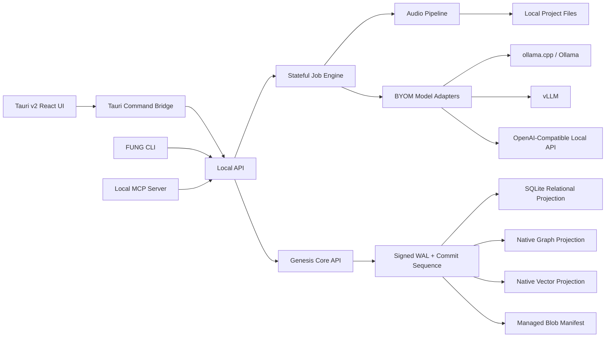
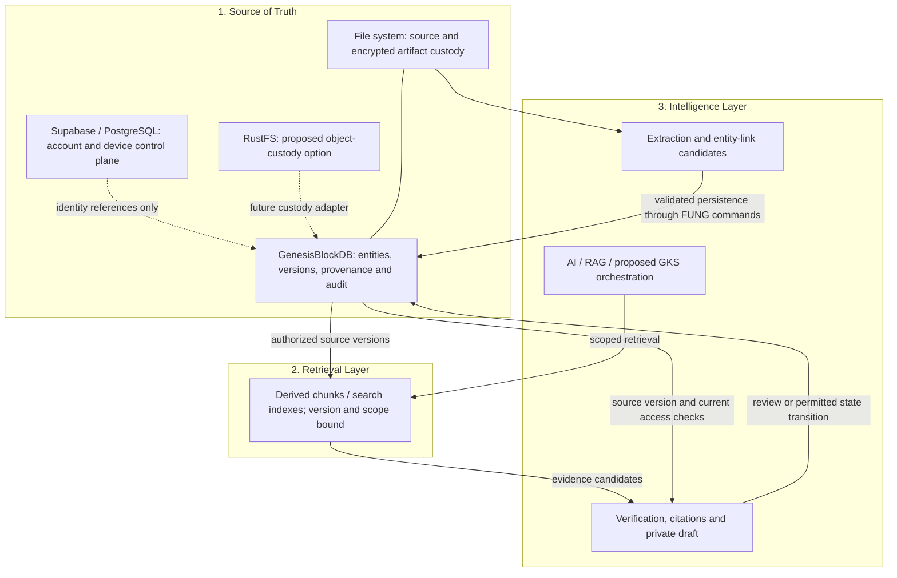

# Technical Design - FUNG Architecture

## Complexity Assessment

Level: C-3 Architecture-Driven Implementation.

เหตุผล: ระบบมี desktop runtime, local database, long-running audio capture, AI model orchestration, MCP/API/CLI, stateful jobs, export pipeline และ legal/privacy constraints.

## Platform Priority

1. Desktop app first.
2. Web app second.
3. Mobile third.

Desktop เป็น primary runtime สำหรับ recording, local files, local DB, model execution และ project state.

## Stack Decision

| Layer | Decision | Responsibility |
| --- | --- | --- |
| Desktop shell | Tauri v2 | Native desktop packaging, file access, secure command bridge |
| UI | React/TypeScript | Timeline, transcript editor, settings, project library |
| Local API | Internal HTTP API | Job control, transcript, export, model orchestration |
| Database boundary | GenesisBlockDB embedded core | Single open/write/query/backup/restore contract for relational, graph, vector and blob metadata |
| Internal relational subsystem | SQLite | Genesis-owned relational projection, joins and schema migrations; never a direct application handle |
| AI runtime | BYOM adapters | ollama.cpp, vLLM, OpenAI-compatible local endpoints |
| Automation | MCP | Tool access for agents and external local workflows |
| CLI | FUNG CLI | Batch import, transcribe, export, diagnostics |
| State | Stateful job engine | resumable recording, processing, export, and summaries |

## Architecture Overview

The runtime diagram below describes the intended component boundary. Use the
three-layer ownership view and its implementation evidence below to distinguish
existing local behavior from target capabilities. Implementation acceptance is
tracked in [Desktop progress](08-real-progress.md), not inferred from a diagram.



## Document and Knowledge Architecture — Three Layers

This is the parent ownership map for FUNG documents, meeting evidence and AI
answers. Detailed behavior remains owned by the [knowledge/evidence
spec](../specs/2026-09-21-meeting-knowledge-evidence-spec.md), the [meeting domain
map](../architecture/MEETING_INTELLIGENCE_DOMAINS.md) and their approved amendments.
The three layers are logical responsibilities; they do not require three
databases or three deployed services. Repository documentation authority and
runtime data authority are separate concepts.



### 1. Source of Truth — ownership, identity and custody

Each class of data has one authoritative writer and a declared custody location.
Trust means traceable origin, integrity, version and authorization; persistence
or a model confidence score alone does not establish that a claim is correct.

| Store / boundary | Authority and responsibility | Current versus target |
| --- | --- | --- |
| File system | Original audio and selected source bytes; encrypted document/chunk assets and exports. A custody reference locates bytes; the registered entity/version and hash identify them. | Local custody is implemented in `genesis_adapter.rs` and `meeting_knowledge.rs`. A path or filename alone is not a stable identity or an authorization grant. |
| GenesisBlockDB | FUNG application entities, PK/FK relations, source versions, private-asset metadata, evidence references and audit records through the FUNG adapter. Internal SQLite/WAL/graph/vector details remain engine-owned. | Embedded adapter and versioned relational schema are present. Generic engine capabilities do not establish that every FUNG document/search feature is wired. |
| PostgreSQL through Supabase | Auth/profile and device-enrollment control-plane records within their server authority. FUNG carries identity references across this boundary. | Repository implementation and historical deployment evidence exist in the [Supabase control-plane contract](../../supabase/README.md). It excludes audio, transcripts, notes, embeddings, graph/WAL and Genesis exports. This review does not revalidate hosted state. A PostgreSQL document store would be a new decision. |
| RustFS | Candidate object custody for large immutable/versioned artifacts, referenced from authoritative metadata. | Proposed only: no FUNG adapter or deployment evidence was found in the inspected source. Selection requires a storage/retention/access decision; no automatic upload or second metadata authority is implied. |

The existing [Genesis adapter schema](../../src-tauri/src/genesis_adapter.rs)
uses `id` as the primary key. Its declared knowledge FK chain is
`knowledge_documents.collection_id -> knowledge_collections.id`,
`knowledge_document_versions.document_id -> knowledge_documents.id`, and
`knowledge_chunks.version_id -> knowledge_document_versions.id`; metric
observations also reference a document version. A unique `(document_id,
version_no)` identifies a document revision within its document. Project,
owner/vault and session scope checks remain necessary in addition to FK checks.
`current_version_id`, custody references and JSON evidence references must not
be described as database-enforced FKs merely because they contain IDs; the
adapter validates their applicable ownership/version relationships.

Keep these identities distinct: stable document/entity ID, document version
ID/number, schema contract version, parser/model fingerprint, index generation,
ACL revision, and model-run/evidence-bundle ID. A corrected transcript or source
creates a traceable revision under its feature contract. An extracted entity
link is an assertion about entities, not a reason to silently rewrite their PKs.
Document-level canonical entity resolution beyond existing reviewed People links
and recording graph extraction remains a target capability.

Source, extracted content and model output retain provenance separately. Audit
records describe actor, action, outcome and references to the affected revision;
they do not certify the truth of extracted content. WAL durability and
application audit are different responsibilities. Private content and secrets
must follow the existing vault/keyring policy rather than being copied into
general logs. Cross-store SQL FKs or a transaction spanning files, PostgreSQL,
RustFS and GenesisBlockDB are not present. Any new custody adapter must specify
staging, metadata commit, orphan cleanup, retry and restore reconciliation before
activation; an acknowledged metadata write alone is not proof of recoverable bytes.

### 2. Retrieval Layer — Search Index

Search returns evidence candidates from permitted source versions. Chunks,
lexical terms, embeddings and graph retrieval projections carry provenance back
to those versions; ranking cannot promote a candidate to a trusted fact.

Current selected-document retrieval is bounded local lexical scoring over
authorized encrypted chunks in
[`search_selected_knowledge`](../../src-tauri/src/meeting_knowledge.rs).
The adapter loads selected active documents/versions and the read boundary
checks scope and grants before decryption. This is not evidence of a dedicated
external search service or a completed vector-search ingestion pipeline.
The schema includes `knowledge_index_runs` and chunk `index_generation`, but
the current import writes generation `1`; a schema field does not prove an
atomic multi-generation index publication/rebuild lifecycle.

The target index contract from the knowledge spec is: bind an index run to exact
input versions, parser/embedding/config fingerprints, coverage and errors; publish
one coherent generation; disclose partial coverage and stale/unavailable state;
rebuild derived indexes from retained authorized source versions. Replacement
must not mix an old title/locator with new content. A missing source or parser
prevents a reproducible rebuild and must be reported. Revocation/deletion makes
the source ineligible immediately; derived indexes, caches and unsent evidence
then follow retention policy. Rebuild, backup restore and revocation propagation
need their own acceptance evidence before being called complete.

### 3. Intelligence Layer — AI / RAG / Genesis Knowledge System

FUNG owns extraction, entity-link review, query planning, evidence selection,
claim verification and answer presentation. **Genesis Knowledge System (GKS)**
is a proposed name for orchestration of those responsibilities here, not an
installed FUNG service or another name for GenesisBlockDB. Its deployment and
adapter contract remain undecided. Current building blocks include
[`graph_build.rs`](../../src-tauri/src/graph_build.rs) (structural graph plus
model-extracted topics/decisions/actions with transcript evidence), local
knowledge parsing/retrieval, reviewed People links and the local agent draft flow.

| Handoff | Required evidence and boundary |
| --- | --- |
| Source -> extraction | Native-selected custody, byte hash and source version; parser/version fingerprint and bounded locators. Current import supports TXT/Markdown and Windows sandboxed text-PDF; other formats/OCR require separate qualification. |
| Extraction -> entity linking | Preserve source spans, extraction provenance and uncertainty. Resolve aliases within authorized scope; ambiguous links remain candidates until the owning review/policy accepts them. |
| Query -> retrieval | Explicit selected collection/project/session scope, current identity/access grants, bounded query and limits. Models cannot broaden scope or use document instructions as permission. |
| Retrieved evidence -> verification | Recheck version and access; inspect claim support, contradictions and gaps. Typed numeric computations retain units, periods and source operands. Confidence, similarity and successful parsing are not verification. |
| Verification -> citation/draft | Bind each supported claim to exact source version/hash and locator. Missing, conflicting or stale evidence yields clarification, partial/unavailable status or an unsupported claim label. Drafting has no send side effect. |
| Draft -> publication | Existing audience/share policy, exact preview/hash, approval and delivery receipt contract apply. Read permission does not grant publication permission; local approval does not prove provider delivery. |

The current `EvidenceCitation` records collection/document/version IDs and
version number, source-version label, content hash, typed locator, retrieval time,
read-grant ID and ACL revision. `EvidenceCitation.content_sha256` is the SHA-256
of the extracted chunk's UTF-8 text (`knowledge_chunks.content_hash`), not the
original file digest. The original selected-file byte digest is stored separately
in `knowledge_document_versions.content_hash`; current import also uses it as
`version_label` / citation `source_version`. Resolve the authorized version row
before verifying the original bytes, and verify a chunk against its own digest.
Do not assume future version labels will always be file digests.

Current TXT/Markdown and text-PDF `start_char` / `end_char` locators are zero-based
Unicode scalar-value offsets into the parser's extracted text, with an exclusive
end. They follow Python string indexing and Rust `.chars()`, not UTF-8 byte,
UTF-16 code-unit or user-perceived grapheme indexes. TXT/Markdown offsets are
document-relative and line numbers are one-based; PDF offsets are page-relative,
with a one-based `page_number`. Chunking preserves the parser page's offset base.
A JavaScript citation viewer must convert scalar offsets before using UTF-16
string APIs when supplementary characters occur. Thai combining sequences must
not be collapsed to grapheme indexes. Normalizing or reparsing text requires an
explicit locator mapping.
Locator type definitions for spreadsheets/transcripts do not
by themselves prove an ingestion or citation-viewer flow for every format.
Revalidate source/account/access state before revealing or publishing content.

### Evidence and remaining decisions

The 2026-10-16 architecture review checked source and existing reports; it did
not execute native knowledge ingestion or retrieval. The subsequent
[UI flow audit](../verification/implementation-reports/2026-10-16-wireframe-wireflow-userflow-audit.md)
records its own browser/CPU checks and retains the native knowledge gates.
The [local M1–M5 implementation report](../verification/implementation-reports/2026-09-24-meeting-intelligence-local-adapters.md)
and [current Desktop progress](08-real-progress.md) own verification history and
remaining provider/device/installed-artifact/release gates. The architecture map
does not close those gates.

Remaining design decisions are RustFS deployment/custody policy; any expansion
of PostgreSQL beyond the current control plane; the GKS service/module boundary;
canonical document-entity linking and promotion policy; and executable index
generation/rebuild/retention acceptance. These require focused contracts and
evidence before changing application storage or activating external services.

## Key Components

### Tauri Desktop App

- Owns native window, menu, file picker, microphone permission, filesystem access, and secure command bridge.
- Does not perform heavy AI work inside UI thread.

#### Native capture authority — bounded implementation checkpoint

The Windows routed coordinator derives project/source bindings from real
GenesisBlockDB Storage. An internal native group factory admits all routes before
any reader starts; the actual client and capture service remain owned on their
MTA. Runtime observers carry revocable weak state, not serialized authority.
Only the exact live owned instance is infrastructure; it cannot arm a renderer.
Stop revokes before native teardown, and completion waits for source termination,
drain, durable custody and fresh final per-source checks. Legacy cleanup cannot
release another owner's capture guard.

Native Tauri inventory/validate/start/status/stop is implemented; no new HTTP/LAN
capture-control surface is added. Existing media consumers reject unsupported
routed/pending records. Source-aware Live/MCP, recovery/export and successful
installed audio capture remain gated. The
[verification checkpoint](../verification/implementation-reports/2026-10-27-runtime-guard-package-qualification.md)
distinguishes reviewed source, 855 library passes/12 ignored and actual installed
negative/reopen checks from still-open endpoint **and** PID acceptance. Audit
receipts or a pure validated route cannot mint native client lifetime authority.

### Local API

- Single local control plane for UI, CLI, and MCP.
- Exposes bounded endpoints for project, recording, jobs, transcript, layers, summary, and export.
- Runs on loopback only by default.

### GenesisBlockDB

- Single operational boundary exposed to FUNG UI/API/CLI/MCP.
- Owns signed WAL authority, commit sequence, relational SQLite projection, native graph/vector projections and managed blob metadata.
- FUNG registers a versioned relational schema package and uses `GenesisTransaction` plus Typed Query IR.
- FUNG must not open SQLite, mutate graph/vector stores independently or maintain cross-store identity mappings.
- Tracks provenance: source audio, model used, parameters, output artifacts and revision history using canonical `EntityId` values.

### Stateful Job Engine

- Every long task is resumable and queryable.
- Recording, transcription, diarization, cleanup, separation, summary, and export are represented as jobs with state transitions.

Job states:

```text
queued -> running -> paused -> completed
queued -> running -> failed -> retrying -> running
running -> cancelled
```

### BYOM Model Adapters

- Users can bring local models or local-compatible endpoints.
- Cloud providers are disabled by default and must require explicit opt-in.

Supported adapter classes:

- Transcription adapter.
- Diarization adapter.
- Noise reduction adapter.
- Source separation adapter.
- LLM summary/intent adapter.

## Local API Surface - V1

| Endpoint Group | Purpose |
| --- | --- |
| `/health` | Runtime readiness and dependency checks |
| `/projects` | Project CRUD and project library |
| `/recordings` | Start, pause, stop, recover recording sessions |
| `/jobs` | Stateful job status, retry, cancel |
| `/transcripts` | Transcript segments, speaker labels, search |
| `/layers` | Audio layers and derived artifacts |
| `/models` | BYOM providers, capabilities, diagnostics |
| `/exports` | WAV, MP3, transcript, summary export |

## Data Model - Initial Entities

| Entity | Purpose |
| --- | --- |
| Project | User workspace for one recording or a group of recordings |
| Recording | Source audio capture/import |
| AudioChunk | Durable chunk file metadata |
| AudioLayer | Original/cleaned/separated/selected layer |
| Speaker | Speaker label and user rename |
| TranscriptSegment | Text, timestamp, speaker reference |
| ModelProvider | BYOM provider config |
| ModelRun | Model execution provenance |
| Summary | Whole-story or speaker-level summary |
| IntentInference | Inferred intent with evidence and confidence |
| ExportArtifact | Exported file metadata |
| AuditEvent | Local audit trail |

## Security and Privacy Defaults

- Loopback-only API by default.
- No cloud upload unless explicitly enabled.
- Local project folder remains user-visible.
- Model runs must record provider, model name, parameters, and output artifact references.
- Intent analysis must be labelled as AI inference.

## Live meeting intelligence extension — candidate, 2026-09-21

The [D1–D13 domain map](../architecture/MEETING_INTELLIGENCE_DOMAINS.md) extends the modular monolith with revisioned live transcription, scoped knowledge/evidence, meeting participation and conversation delivery. The existing Desktop GenesisBlockDB remains the authoritative application persistence boundary. No independent transcript/vector/people database is introduced.

- [Live transcript spec](../specs/2026-09-21-live-meeting-transcription-spec.md): source coverage, provisional/committed revisions, replay cursors and resource budgets.
- [Knowledge spec](../specs/2026-09-21-meeting-knowledge-evidence-spec.md): selected collections, exact source versions, citation and audience/share checks.
- [Meeting Agent spec](../specs/2026-09-21-meeting-agent-participation-spec.md): session policy, visible join, grounded triggers, durable publication outbox and receipts.
- [Google Meet API strategy](../decisions/2026-09-21-google-meet-agent-api-strategy.md): Google Meet first, API participant attribution; official receive-only preview versus candidate managed bot for actual chat interaction.

The managed-bot proposal adds an **optional external transport/control gateway**, requiring a public verified WSS/HTTPS ingress, Desktop outbound authenticated WSS and a bot lease watchdog. Its bounded encrypted transport buffer/minimal durable control journal is not a second application knowledge store. This is new infrastructure requiring deployment/privacy approval; neither the current loopback API nor LAN FUNGWIRE becomes internet-facing.

Local-only capture remains available. API mode explicitly discloses third-party meeting-media access even when Whisper and knowledge run locally. Provider identity is source metadata, not a verified Person or authorization principal. Human/agent identities, read rights and publication rights remain separate.

Existing manual external MCP stays read-only/per-call approved. The new participant/publication boundary is separately default-off. Meeting Agent cannot call vendor endpoints directly from model-generated tools or UI code.

The original 2026-09-21 proposal and bounded R3 AccountCommitFence foundation
were followed by the approved local M1–M5 implementation recorded in
[Desktop progress](08-real-progress.md) and its linked 2026-09-24 implementation
report. Local revisioned transcripts, selected knowledge/People operations,
private agent drafts and preview/outbox controls have source and recorded local
verification evidence. Full provider gateway, real-room publication/receipts,
latency, device and release acceptance remain separate gates. Speaker recognition
remains optional when participant-track attribution is sufficient; shared-room
microphones still need anonymous diarization/review.

## Risks

| Risk | Level | Mitigation |
| --- | --- | --- |
| Long recording data loss | High | Chunked files, Genesis blob manifest, signed WAL and recovery scan |
| Model runtime instability | High | Adapter isolation, diagnostics, graceful fallback |
| Legal/privacy misuse | High | Local-first defaults, consent UX, audit trail, disclaimers |
| Speaker misclassification | Medium | Editable labels, confidence display, no identity claims |
| Heavy CPU/GPU load | Medium | queue control, pause/resume, runtime profile |

## Implementation Plan

### Phase 0 - Documentation Approval

- Product spec.
- Architecture.
- Audio AI pipeline.
- Design system.
- Legal/privacy model.

### Phase 1 - Desktop Foundation

- Tauri v2 scaffold.
- React shell.
- Genesis embedded core initialization and one database root.
- FUNG relational schema package plus typed query/transaction adapter.
- Local API health and project CRUD.

### Phase 2 - Recording Core

- Long recording session.
- Chunked audio persistence.
- Recovery scan.
- WAV export.

### Phase 3 - AI Pipeline MVP

- BYOM provider registry.
- Transcription adapter.
- Speaker diarization adapter.
- Transcript editor.

### Phase 4 - Audio Enhancement and Layers

- Noise reduction.
- Layer artifacts.
- MP3 export.

### Phase 5 - Summary and Intent

- Whole-story summary.
- Speaker-level summary.
- Intent inference with evidence.
- MCP and CLI automation.

## Version Diff

| Version | Change |
| --- | --- |
| 1.2.1b | Added the bounded implemented native capture ownership/custody boundary and Tauri-only execution scope, retaining source-aware consumer and both installed audio gates. |
| 1.2.0b | Added the three-layer document/knowledge ownership map, current storage and retrieval evidence, identity/citation/trust boundaries and remaining decisions; reconciled the local M1–M5 status pointer. |
| 1.1.1b | Clarified the bounded R3 native SI/D8 AccountCommitFence implementation exception without promoting the broader D1–D13 meeting-intelligence contracts to implementation. |
| 1.1.0b | Added candidate live-transcript, knowledge, Google Meet agent and governed external gateway boundaries while retaining Genesis authority. |
| 0.1.0b | Initial architecture with desktop-first Tauri v2, SQLite WAL, GenesisBlockDB, API, MCP, CLI, BYOM runtimes, and stateful jobs. |
| 1.0.0b | Corrected GenesisBlockDB to the single operational boundary with internal SQLite relational, native graph/vector, managed blob and signed WAL authority. |

## CHANGELOG

| Version | Date | Status | Summary | Commit Hash | Agent |
|---------|------|--------|---------|-------------|-------|
| 1.2.1b | 2026-10-27 | candidate | Recorded reviewed native-owned routed capture and separate installed negative/reopen evidence; no audio acceptance, architecture-wide adoption or release claim. | see Git history | Codex |
| 1.2.0b | 2026-10-16 | candidate | Reviewed Source of Truth, Retrieval and Intelligence ownership; distinguished existing Genesis/files/Supabase behavior from proposed RustFS/GKS/index lifecycle. Documentation review only; no runtime verification. | working-tree | Codex (Astra review) |
| 1.1.1b | 2026-09-23 | candidate | Clarified current bounded R3 AccountCommitFence evidence versus the still-candidate D1–D13 capability surface. | working-tree | RWANG |
| 1.1.0b | 2026-09-21 | candidate | Added candidate live-transcript, knowledge, Google Meet agent and governed external gateway boundaries while retaining Genesis authority. | working-tree | RWANG |
| 0.1.0b | 2026-07-05 | beta | Initial technical design. | N/A | ATHER |
| 1.0.0b | 2026-07-20 | candidate | Structural correction to the GenesisBlockDB unified operational boundary | N/A — no commit created | ATHER |
