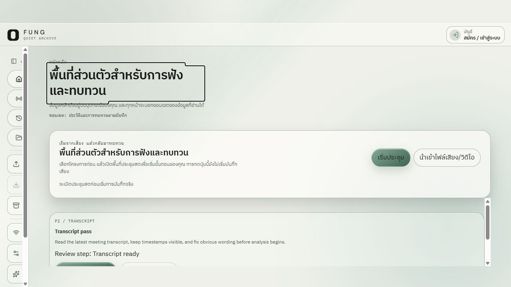
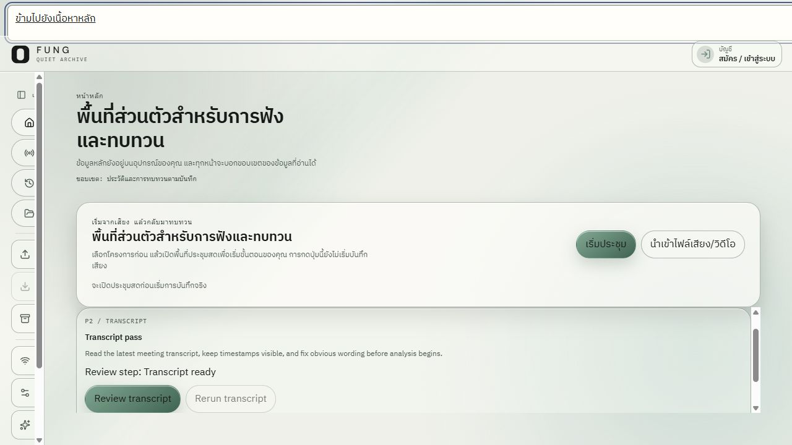
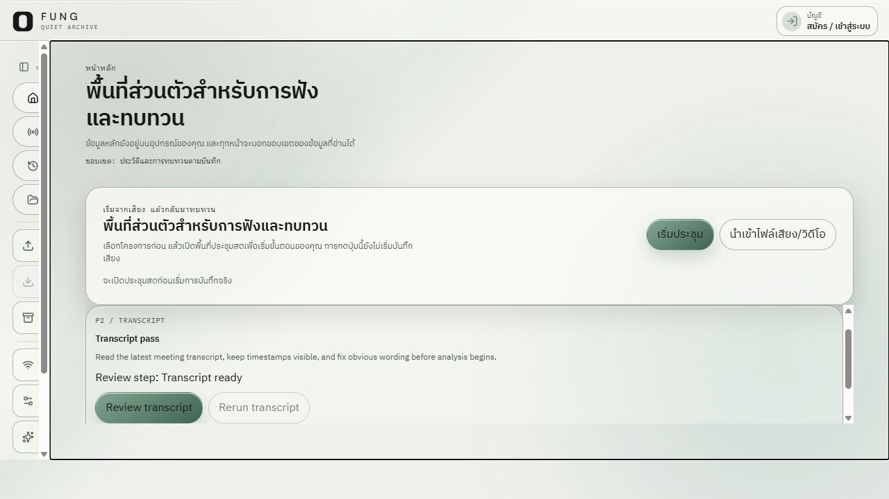

# FUNG Desktop Home — combined UX and accessibility review

Date: 2026-10-16  
Status: **Partial review; not an accessibility conformance audit.**

## 1. Audit scope

- **User goal:** reach the Home content and its primary actions, then bypass the shell navigation with a keyboard.
- **Surface:** FUNG Desktop Home, light theme.
- **Capture source:** current checkout served as a Vite production preview at `http://127.0.0.1:4173/app?surface=desktop` in the Codex in-app browser, at 1280×720.
- **Accessibility target:** WCAG 2.2 AA considerations for this sample only. No whole-product conformance claim is made.
- **Runtime boundary:** the preview reports `NATIVE_UNAVAILABLE` for desktop-owned project state. It does not prove behavior with a real FUNG profile or native commands. The prior app URL on port 1421 refused the connection, so this review used the isolated production preview.
- **Method:** current-run screenshots, the browser accessibility tree, keyboard focus movement, and Enter activation of the skip link.

## 2. Steps and evidence

| # | Step | General health |
| --- | --- | --- |
| 1 | Load Home and inspect the first viewport | PARTIAL PASS — primary content renders and focus is visible; separate scroll regions and below-fold content need review. |
| 2 | Keyboard-focus the skip link | PASS — the link is named and becomes visible when focused. |
| 3 | Activate the skip link | PASS — the URL hash changes to `#desktop-shell-main` and focus moves to the main container. |

### Step 1 — Home first viewport

The Home page exposes a level-one heading, local-data scope copy, meeting and import actions, and transcript review. The screenshot shows the heading focus outline. At this viewport, the sidebar and main content each have their own vertical scrollbar; part of the transcript panel sits below the visible area. This is an observed layout condition, not proof that either scroll region is broken.

### Step 2 — Skip link receives keyboard focus

The accessibility tree exposes “ข้ามไปยังเนื้อหาหลัก”. The link becomes visible at the top of the viewport when focused. In this sample it was reached during keyboard traversal; activating visible Home actions was not part of this check.

### Step 3 — Skip link activation

Pressing Enter updated the URL to `#desktop-shell-main` and the accessibility tree reported focus on the `main` container. Its outline is visible in the screenshot. This confirms the bypass link behavior for this route in the web preview.

## 3. Confirmed strengths

- Home has a named level-one heading and the sampled navigation, account and action controls have accessible names in the browser tree.
- A visible keyboard focus indicator appeared on both the Home heading and the main container.
- The skip link is present, becomes visible on focus, and moves focus to the main content when activated.
- The page explains that local data and recording state remain separate from appearance changes.

## 4. UX and accessibility risks

- **Separate scroll regions:** the screenshot shows independent scrolling in the sidebar and main content. This can make wheel and keyboard scroll ownership less clear, especially when content extends below the first viewport. Test both regions in the packaged desktop window and ensure focus movement scrolls the focused control into view.
- **Translucent contrast:** this review did not measure rendered text contrast over the glass surfaces or background imagery. The 58 solid-color pairs in [the contrast report](CONTRAST_REPORT.md) do not cover translucent compositing.
- **Focus appearance:** the outlines are visible in the screenshots, but their contrast, thickness and spacing were not measured against every background or control state.
- **Control behavior:** the sample checks names and focus reachability, but does not activate meeting, import, transcript, account, pairing or modal flows.

## 5. WCAG-relevant observations

| Area | Evidence | Result |
| --- | --- | --- |
| 2.4.1 Bypass Blocks | Skip link is visible on focus; Enter moves focus to main. | Positive sample for Home. |
| 2.1.1 Keyboard | Initial focus was on the Home heading; Tab reached the Start Meeting action; the skip link was keyboard-reachable. | Partial; full task paths and dialogs were not traversed. |
| 2.4.7 / 2.4.11 Focus visibility and appearance | Main heading and main container outlines are visible. | Partial; contrast and minimum-area measurements remain open. |
| 1.4.3 / 1.4.11 Contrast | Declared solid-color pairs pass the project report. | Partial; glass, overlays, imagery and hover/disabled states were not measured. |
| 1.4.10 Reflow and 1.4.4 Resize Text | One 1280×720 viewport was captured. | Not checked at narrow widths or 200% text/zoom. |
| 2.2.2 Motion | No reduced-motion preference was exercised. | Not checked. |
| 4.1.2 Name, Role, Value | Sampled controls and headings appear in the browser accessibility tree. | Partial; no screen-reader session or whole-app tree review. |

## 6. Evidence limits and remaining acceptance work

This is one route, one light-theme viewport and one web preview. It does not cover dark/system themes, reduced transparency, all important routes, empty/error/recovery states, modal focus trapping/restoration, forced colors, reduced motion, 200% zoom, mobile touch targets, a screen reader, native WebView behavior, installer or clean-install state. The preview cannot read real projects because the native bridge is unavailable.

Keep overall accessibility status **partial** until the remaining route, theme, zoom, forced-color, reduced-motion, assistive-technology, modal, mobile and native checks have evidence. See [package verification](PACKAGE_CHECK.md) for the separate design-system and delivery gates.
