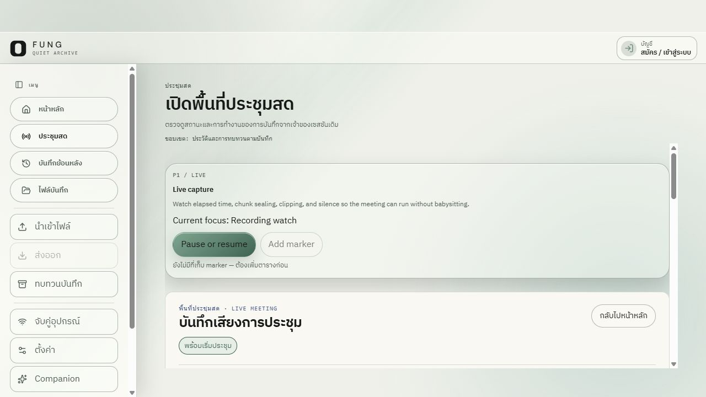
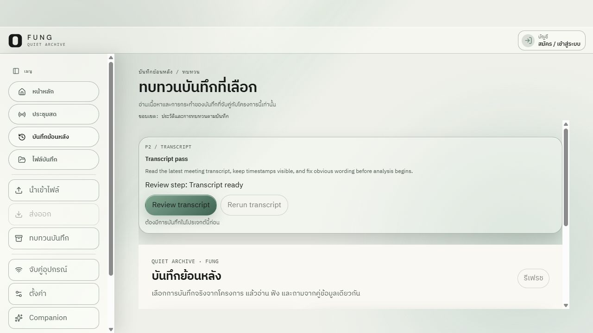
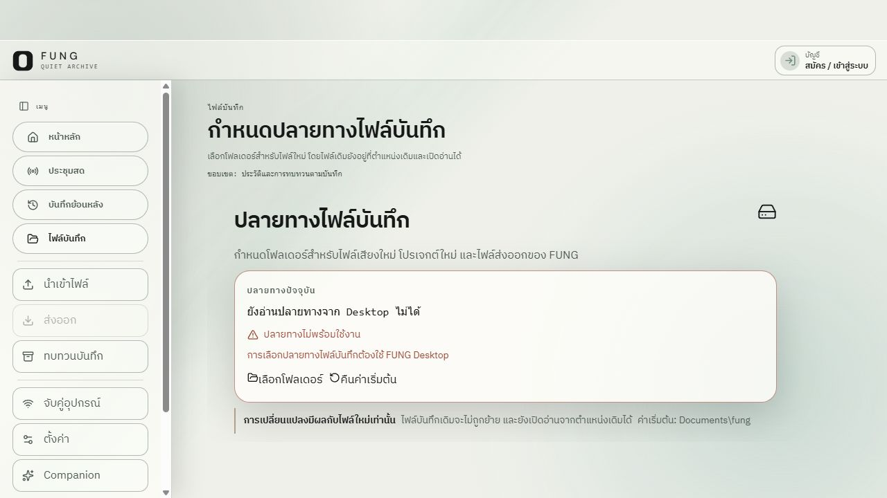
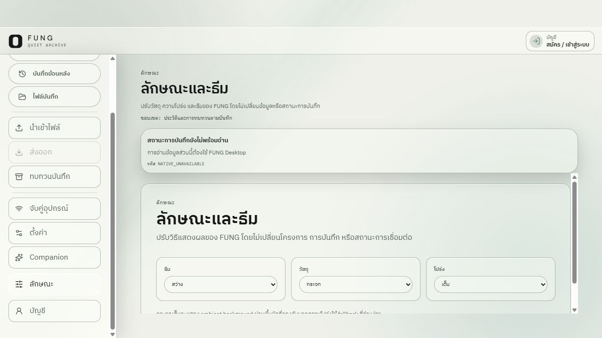

# FUNG Desktop routes — combined UX and accessibility review

Date: 2026-10-16  
Status: **Partial review; not an accessibility conformance audit.**

## 1. Audit scope

- **User goal:** reach the Home content and its primary actions, then bypass the shell navigation with a keyboard.
- **Surface:** Home, Live, History, Files and Appearance in the Desktop shell, light theme.
- **Capture source:** current checkout served as a Vite production preview at `http://127.0.0.1:4173/app?surface=desktop` in the Codex in-app browser, at 1280×720.
- **Accessibility target:** WCAG 2.2 AA considerations for this sample only. No whole-product conformance claim is made.
- **Runtime boundary:** the preview reports `NATIVE_UNAVAILABLE` for desktop-owned project state. It does not prove behavior with a real FUNG profile or native commands. The prior app URL on port 1421 refused the connection, so this review used the isolated production preview.
- **Method:** current-run screenshots and accessibility-tree snapshots for all five routes; keyboard focus movement and Enter activation of the skip link were checked on Home, and Tab order was checked across the three Appearance selectors. Route navigation did not start capture, import files, or change appearance controls.

## 2. Steps and evidence

| # | Step | General health |
| --- | --- | --- |
| 1 | Load Home and inspect the first viewport | PARTIAL PASS — primary content renders and focus is visible; separate scroll regions and below-fold content need review. |
| 2 | Keyboard-focus the skip link | PASS — the link is named and becomes visible when focused. |
| 3 | Activate the skip link | PASS — the URL hash changes to `#desktop-shell-main` and focus moves to the main container. |
| 4 | Activate Home “เริ่มประชุม” | PARTIAL PASS — opens Live setup; the actual start button remains disabled until participant notice is confirmed, and native capture is unavailable. No recording was started. |
| 5 | Open Live from shell navigation | PARTIAL — setup and empty-state content render; the native bridge reports `NATIVE_UNAVAILABLE`. |
| 6 | Open History from shell navigation | PARTIAL — the no-project state is named and readable; no recording data is available in the web preview. |
| 7 | Open Files from shell navigation | PARTIAL — the unavailable destination is explained and native-dependent controls are disabled. |
| 8 | Open Appearance from shell navigation | PARTIAL — theme, material and transparency controls are named; no setting was changed and native preference persistence was not checked. |
| 9 | Tab through the Appearance controls | PARTIAL PASS — the accessibility tree reported focus moving through theme, material and transparency selectors in order. No option was selected; focus contrast was not measured. |

### Step 1 — Home first viewport

The Home page exposes a level-one heading, local-data scope copy, meeting and import actions, and transcript review. The screenshot shows the heading focus outline. At this viewport, the sidebar and main content each have their own vertical scrollbar; part of the transcript panel sits below the visible area. This is an observed layout condition, not proof that either scroll region is broken.

### Step 2 — Skip link receives keyboard focus

The accessibility tree exposes “ข้ามไปยังเนื้อหาหลัก”. The link becomes visible at the top of the viewport when focused. In this sample it was reached during keyboard traversal; activating visible Home actions was not part of this check.

### Step 3 — Skip link activation

Pressing Enter updated the URL to `#desktop-shell-main` and the accessibility tree reported focus on the `main` container. Its outline is visible in the screenshot. This confirms the bypass link behavior for this route in the web preview.

## 3. Additional route snapshots

### Live

After the correction, activating Home’s “เริ่มประชุม” action opened Live setup. The current route and `Capture setup` card are recorded in [this flow screenshot](screenshots/10-home-start-meeting-live-setup.png). The accessibility tree showed “พร้อมเริ่มประชุม”, a disabled start button pending participant notice, and `NATIVE_UNAVAILABLE`. This verifies the web-preview transition only, not native capture.

The setup card exposes participant-notice consent, system-audio selection, language and transcript-format controls in the accessibility tree. The start control is disabled until notice is confirmed, and the native capture state reports `NATIVE_UNAVAILABLE`; this preview did not start a recording. The first Live snapshot ([before correction](screenshots/04-live-workspace-production-preview.png)) showed an enabled “Pause or resume” button while the panel said “พร้อมเริ่มประชุม”. Source inspection showed that this `record` action opens the Live panel; it does not pause or resume capture. I changed its label to **“Open live capture”** and the card status to **“Capture setup”**. The rebuilt preview and current accessibility tree confirm the revised copy in [the follow-up screenshot](screenshots/09-live-action-label-after-fix.png). Clicking this card while Live was already open caused no state change; native capture behavior remains unverified.

### History

The no-project state explains that a project must be selected before history can load. Refresh is disabled. This confirms the web preview's empty state, not real profile or recording behavior.

### Files

The destination page states that it cannot read the current path from Desktop and disables folder-selection and reset controls. The copy distinguishes new files from existing files. This is an explicit native-unavailable state; file destinations were not changed.

### Appearance

The current controls expose light theme, glass material and full transparency. The native preference status is unavailable in the preview. No selection was changed, so this does not establish persistence, system-theme behavior or rendered parity across themes.

The accessibility tree reported keyboard focus moving through these three selectors in order. The focus sample is [captured here](screenshots/08-appearance-transparency-focused.png); a distinct focus ring is not clear in this frame, so focus appearance still needs visual acceptance.

All four initial route screenshots show separate vertical scrollbars for the sidebar and main content. At this viewport, the shell requires users to manage two independent scroll regions. This is an observed interaction risk; the screenshots do not establish whether focus can ever move to content outside the viewport.

## 4. Confirmed strengths

- Home has a named level-one heading and the sampled navigation, account and action controls have accessible names in the browser tree.
- A visible keyboard focus indicator appeared on both the Home heading and the main container.
- The skip link is present, becomes visible on focus, and moves focus to the main content when activated.
- The page explains that local data and recording state remain separate from appearance changes.

## 5. UX and accessibility risks

- **Separate scroll regions:** the screenshot shows independent scrolling in the sidebar and main content. This can make wheel and keyboard scroll ownership less clear, especially when content extends below the first viewport. Test both regions in the packaged desktop window and ensure focus movement scrolls the focused control into view.
- **Live action behavior:** the misleading label is corrected in the current branch. Its handler still opens the Live panel, and real capture behavior needs native acceptance because the preview reports `NATIVE_UNAVAILABLE`.
- **Translucent contrast:** this review did not measure rendered text contrast over the glass surfaces or background imagery. The 58 solid-color pairs in [the contrast report](CONTRAST_REPORT.md) do not cover translucent compositing.
- **Focus appearance:** the outlines are visible in the screenshots, but their contrast, thickness and spacing were not measured against every background or control state.
- **Control behavior:** Home’s “เริ่มประชุม” action opens setup without starting capture. The sample did not start a recording or activate import, transcript, account, pairing or modal flows.

## 6. WCAG-relevant observations

| Area | Evidence | Result |
| --- | --- | --- |
| 2.4.1 Bypass Blocks | Skip link is visible on focus; Enter moves focus to main. | Positive sample for Home. |
| 2.1.1 Keyboard | On Home, Tab reached the Start Meeting action and the skip link was keyboard-reachable. On Appearance, Tab reached the theme, material and transparency selectors in order. | Partial; full task paths and dialogs were not traversed, and the selectors were not changed. |
| 2.4.7 / 2.4.11 Focus visibility and appearance | Main heading and main container outlines are visible. | Partial; contrast and minimum-area measurements remain open. |
| 1.4.3 / 1.4.11 Contrast | Declared solid-color pairs pass the project report. | Partial; glass, overlays, imagery and hover/disabled states were not measured. |
| 1.4.10 Reflow and 1.4.4 Resize Text | One 1280×720 viewport was captured. | Not checked at narrow widths or 200% text/zoom. |
| 2.2.2 Motion | No reduced-motion preference was exercised. | Not checked. |
| 4.1.2 Name, Role, Value | Sampled controls and headings appear in the browser accessibility tree. | Partial; no screen-reader session or whole-app tree review. |

## 7. Evidence limits and remaining acceptance work

This is five shell routes, one light-theme viewport (1280×720) and one web preview. It does not cover dark/system themes, reduced transparency, all component states, modal focus trapping/restoration, forced colors, reduced motion, 200% zoom, mobile touch targets, a screen reader, native WebView behavior, installer or clean-install state. The preview cannot read real projects because the native bridge is unavailable. The route snapshots are not full-screen design exports.

Keep overall accessibility status **partial** until keyboard paths, other themes, zoom, forced colors, reduced motion, assistive technology, modal behavior, mobile and native checks have evidence. The Live action copy is corrected; its native behavior remains unverified. See [package verification](PACKAGE_CHECK.md) for the separate design-system and delivery gates.
