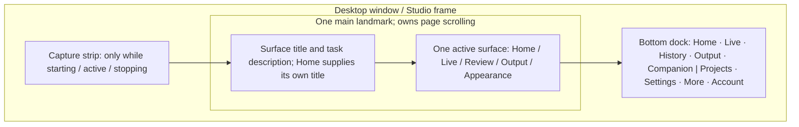
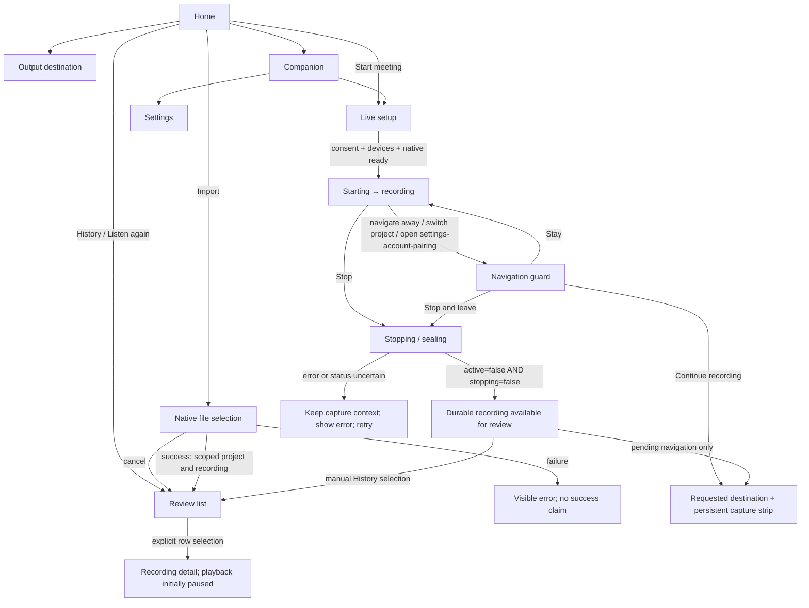
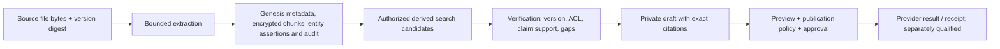

# FUNG — Current wireframes, wireflows and user flows

## 1. Authority and scope

This document owns the current Studio dashboard anatomy, navigation placement,
surface mapping and flow handoffs. It replaces the shell/sidebar placement in
the [September shell refresh](2026-09-19-liquid-glass-desktop-shell-refresh.md)
and the shell portions of [P1–P4 wireframes](../Desktop/wireframes/README.md).
Their domain requirements and historical evidence remain readable.

The [Liquid Glass addendum](../FUNG_Design_System_v0.1.0/LIQUID_GLASS_DESKTOP_ADAPTATION.md)
owns material/fallback rules. The [Desktop contracts](../specs/2026-09-17-callmd-desktop-contracts.md)
own recording scope, playback and recording Q&A. The [three-layer architecture](../Desktop/ARCHITECTURE.md#document-and-knowledge-architecture--three-layers)
owns data authority, retrieval and intelligence boundaries. Detailed feature
contracts retain their own approval states; this document does not activate them.

Current source: [DesktopShell](../../src/components/desktop/DesktopShell.tsx),
[StudioHome](../../src/components/desktop/StudioHome.tsx),
[App composition](../../src/App.tsx), [LiveWorkspace](../../src/components/desktop/LiveWorkspace.tsx),
[RecordingReview](../../src/components/desktop/RecordingReview.tsx),
[RecordingOutputPanel](../../src/components/desktop/RecordingOutputPanel.tsx),
[SettingsPanel](../../src/components/SettingsPanel.tsx) and
[CompanionPanel](../../src/components/desktop/CompanionPanel.tsx).
Screenshots, executed steps, fixes and remaining gates are in the
[current audit report](../verification/implementation-reports/2026-10-16-wireframe-wireflow-userflow-audit.md).

## 2. Wireframe anatomy

These are structural region maps, not new visual mockups. Current screenshots
are linked from the audit. Do not reproduce the former fixed HUD or sidebar
when implementing a new screen inside this shell.

| Surface / region | Information order and controls | Ownership and state requirements |
| --- | --- | --- |
| Home hero | Project picker; headline; actual project/capture facts; Start meeting; four shortcuts | Start opens Live setup only. Project count is unknown when unavailable, not zero. Capture availability must not be inferred from a browser fallback. |
| Home assistant card | Decorative illustration; Companion shortcut; brief capability disclosure | Artwork has empty alt and is not a live microphone or inference meter. The card opens an in-app shortcut panel. |
| Home local-space card | Project count; capture status; selected project; local storage disclosure | Metadata comes from the native owner. Show unavailable/error/loading independently. |
| Home activity card | 7/30-day selector; project creation counts; totals; project shortcut | This chart counts created projects, not meetings or AI activity. No synthetic bars on an unavailable read. |
| Live | Surface introduction; current read/error; capture setup/status; persisted transcript; topic/ask/summary context | One persistent Live owner; controls belong to LiveWorkspace. No legacy tile toolbar, marker placeholder or static "recording ready" claim above it. |
| Review | Introduction; project recording list; selected recording detail; explicit playback; transcript/summary/ask; recording jobs and artifacts | One persistent Review owner. Every read/action uses the selected `(projectId, recordingId)`. Detail is a region, not a nested main landmark. |
| Output | Current path/status; Choose folder; Reset; new-files-only notice | Native folder chooser; locked during capture and while saving. Preserve previous roots for old files. This is a destination preference, not a file browser. |
| Appearance | Theme; material; transparency; readable fallback explanation | Independent from capture/data reads. Do not show unrelated native-capture failures or recording-scope notes here. |
| Project disclosure | Loading/error/unavailable/empty/list; selected recording context; recovery notices; Close list | Opening or closing the disclosure does not open/close a database/project or start recording. Empty recovery wrappers are hidden. |
| More disclosure | Import; open Review for explicit export selection; pairing; Appearance; Account | Accessible names remain present even when icons are shown. Export shortcut creates no job until the user chooses a recording and uses its scoped action. |
| Settings dialog | Close; section choices; active panel | Focus enters the dialog, Tab stays within visible enabled controls, Escape closes and restores the initiating control. Embedded panels are regions rather than nested modal dialogs. |
| Companion dialog | Close; context/status; Live and Settings shortcuts; in-app disclosure | Opening does not start capture or AI inference. No arbitrary prompt, autonomous agent or external overlay capability is implied. |
| Pairing dialog | Close; device read/error; explicit create-code/refresh controls; FUNGWIRE status/actions | Loads its overlay independently of Settings; focus enters Close, Tab loops, Escape restores More. Merely opening does not grant trust or enable FUNGWIRE. |

### Responsive and accessibility contract

- The document/root stays within the viewport; the active main owns scrolling.
  Home cards stack when width requires it. Dock items remain reachable with
  text or accessible names. Project/utility disclosures have bounded overflow.
- Existing Live/Review readers own only bounded internal readers, not another
  full-page scroller. Fixed dialog overlays do not create shell grid rows.
- Keep a single page `main`, one active page H1, visible keyboard focus, the
  skip link and native select labels. Navigation focuses the active heading.
- Settings, Pairing and Companion trap Tab and support Escape. Native pickers remain
  OS-owned. Destructive/provider/security confirmations retain their own policy.
- Dark, light and system themes use the same semantic surface/ink pairs.
  Error text must remain readable on its card. Reduced motion/transparency and
  forced colors require separate checks; a screenshot is not WCAG certification.

## 3. Wireflow — navigation and capture safety

Surface IDs are `home|live|review|output|appearance`. Dock `#history` maps to
`review`; the hash in the anchor is a presentation link, not a durable router
contract. `activeSurface` is React state; reload starts at Home. Settings,
Projects, Pairing and Companion are overlays/disclosures, not additional routes.

Continue recording never relinquishes the Live owner. Stop-and-leave waits for
the owner's acknowledgement; a pending request, timeout or null status does not
prove recording has stopped. Starting capture first requires the Review player
to acknowledge close. Pair changes invalidate prior reads and playback handles.

## 4. Detailed user flows

`SOURCE` below means the handler/controller exists. `BROWSER` means a step was
exercised in the current browser run. `CPU` means a named automated controller
check was executed. None means native/device/provider acceptance by itself.

| ID / user goal | Preconditions and ordered path | Completion / recovery | Current evidence boundary |
| --- | --- | --- | --- |
| UF-01 Enter a meeting | Home → Start meeting → inspect devices/language/transcript mode → acknowledge participant notice → Start | Only a real native start creates capture; unavailable/permission/device errors keep setup and explain the cause | BROWSER entry/unavailable; SOURCE capture; CPU start-close guard |
| UF-02 Finish recording | Live active → Stop → wait for stopping/sealing → inactive owner status → Review | Remain in capture context on stop failure; do not announce completion from the click | SOURCE + CPU lifecycle; native recording/soak not rerun |
| UF-03 Leave during capture | Any guarded navigation or project/account/settings/pairing action → Stay / Continue / Stop and leave | Stay restores initiator; Continue retains owner and strip; Stop waits for both inactive flags | SOURCE + CPU three-choice/stop confirmation; active native UI not exercised |
| UF-04 Import audio/video | Home shortcut or More → Review destination → native picker → import/transcription job → list refresh | Cancel creates no job; missing native/runtime or job failure remains visible | SOURCE import; BROWSER native-unavailable path only |
| UF-05 Select a project | Hero/local card/dock → project disclosure → select an actual project | No automatic recording/playback; reject or clear mismatched recording selection; closing only closes list | BROWSER unavailable disclosure; SOURCE project switching; CPU pair-scope |
| UF-06 Read a past recording | History → project list → explicit recording row → detail → transcript/summary | Distinguish loading, unavailable, empty, stale/error and recovered; release list snapshot on refresh/disposal | BROWSER no-project state; SOURCE + CPU selected-pair and paging |
| UF-07 Listen/seek | Selected recording → open supported channel paused → Play → seek/pause → close | Await close before capture; reject unsupported/missing source; ignore stale playback epoch responses | SOURCE + CPU playback races/close; real speaker/audio not rerun |
| UF-08 Ask from a recording | Select recording → type bounded question → Ask → answer with transcript sources | No automatic fallback to another recording, live tail or graph; insufficient evidence/provider failure remain explicit | SOURCE + CPU scope/race; no model inference in this audit |
| UF-09 Reprocess/export selection | Review detail → chosen job (retry/detailed/speaker/summary/export) → job notice → refresh artifact/result | Pair is captured at click; detailed mode requires readiness; reject stale proposals; completion requires actual artifacts | SOURCE + CPU job-pair boundary; real provider/export not rerun |
| UF-10 Enter export from More | Choose project → More → Export → Review → select recording → UF-09 | Disabled without a project; opening Review queues no job. Never substitute project-current recording for the historical recording the user selects | SOURCE + BROWSER disabled/no-project path; CPU selected-recording job scope |
| UF-11 Set output destination | Output → native folder chooser → validate writable path → save | Cancel retains value; capture/busy locks changes; existing files stay at old roots; failure does not claim path saved | BROWSER disabled/unavailable; SOURCE + CPU custody/lock contract |
| UF-12 Change appearance | More → Appearance → theme/material/transparency | Display state is session-scoped; current reload resets Light/Glass/Full. Capture/data unavailable state is irrelevant. Durable Desktop appearance preferences remain a separate improvement | BROWSER entry and light/dark roundtrip; SOURCE session-state ownership |
| UF-13 Settings and account | Dock Settings or Account → dialog → selected section → close/Escape | Restore focus; account sign-in is optional; no auth endpoint/secure-storage/provider proof is inferred from visible buttons | BROWSER focus/keyboard/config boundary; SOURCE account handlers |
| UF-14 Pair a device | More → Pair → native account/device authority checks → explicit enrollment/pair approval | Denied/revoked/unavailable stays fail-closed; viewing must not grant trust | BROWSER dialog/read-failure/keyboard; SOURCE ceremony; real second-device ceremony not executed |
| UF-15 Back up/restore | Settings → Sign In and Backup → configured local export/restore actions → confirmation and result | Preserve data custody, show path and recovery result; clean-install/backup-password/device proof retain separate gates | SOURCE; no user backup/import modified in this audit |
| UF-16 Use Companion | Home assistant/dock → context panel → Live or Settings → close | Open itself triggers no capture/inference; current panel offers navigation, not a prompt/chat session | BROWSER entry/close; SOURCE shortcuts |
| UF-17 Use local knowledge/People | Review selected pair → Meeting Intelligence → unlock vault → select/import collection → retrieve/review exact evidence/People candidates | Explicit source/ACL scope, encrypted assets, exact version/chunk digest and scalar locator; ambiguity stays a candidate | SOURCE + CPU UI argument/readiness coverage; native private-source UAT not rerun |
| UF-18 Publish an agent draft | Private cited draft → preview/policy/hash approval → permitted outbox | Local approval is not a provider receipt; unavailable external dispatch must stay unavailable | SOURCE + CPU disabled external boundary; provider/room flow NOT_RUN |

### Three-layer handoff for UF-17 / UF-18

## 5. Cross-platform route and flow crosswalk

The [root router](../../src/lib/bootstrap.ts) and [main composition](../../src/main.tsx)
decide the surface before render. A small viewport does not turn Desktop preview
into the native Mobile app.

| Entry | Source behavior | Verification boundary |
| --- | --- | --- |
| `/app?surface=desktop` | Desktop shell in browser; Tauri APIs unavailable | Current browser audit target; cannot validate native data/capture |
| Tauri Desktop default | Desktop shell with native bridge | Existing reports, not a newly rebuilt native executable in this audit |
| Tauri Android/iOS default | Mobile shell selected from platform; explicit surface override wins | Android source/build evidence is separate from physical-device tests; iOS qualification remains separate |
| `/app?surface=mobile` in browser | Mobile route; requires configured Supabase under current bootstrap | Configuration boundary is a named blocker, not missing Mobile implementation |
| `/app` in browser | Auth-guarded Web Dashboard | Requires configured Supabase and session; auth/provider flow not executed here |
| `/auth/callback` | Configured browser auth callback | No OAuth login or credential flow performed |
| `/` and unmatched browser paths | Landing | Marketing/navigation surface, not proof of native workflow support |

[MobileApp](../../src/mobile/MobileApp.tsx) implements tabs `home`, `files`,
`voice`, `notes`, `devices`, plus nested `graph` and `timeline` destinations.
The M1–M8 product IDs in the inventory are product domains, not eight separate
route components. Notes detail/editor share NotesScreen; TimelineScreen and
CreativeStudio contain additional product flows.

Mobile source path: Home → Voice capture → pause/resume/stop/save → Files;
Notes → select/edit/save note → Graph or related Timeline; Devices → explicit
account/pairing → delegation/status/revoke; Timeline → source playback and
reviewed speaker/processing flows. Native foreground service, app-kill recovery,
permissions, real transport, actual DSP/STT/TTS and private data preservation
require the gates in [Mobile status](../Mobile/IMPLEMENTATION_STATUS.md).
Source inspection found a Graph search icon with no click handler; this repair
removes that enabled dead control. Mobile Graph search remains an unimplemented
journey and must not be advertised until search behavior is delivered and tested.

## 6. Maintenance and acceptance checklist

1. Any surface/action change updates this map and the [interface inventory](../UI_INTERFACE_INVENTORY.md).
2. Keep current layout pointers, material/token owners and runtime evidence separate.
3. Capture visible start, loading/empty/error, completion and recovery states for
   each affected journey; preserve exact user artifacts before native restarts.
4. Verify scoped recording actions, delayed responses, capture navigation and
   player-close acknowledgement with the existing controller suites.
5. Requalify keyboard, narrow/short viewports, theme, reduced motion/transparency
   and native frame behavior after related changes. State any blocked steps.
6. Do not mark a wireframe or source handler as end-to-end acceptance.

## CHANGELOG

| Version | Date | Status | Summary | Commit Hash | Agent |
| --- | --- | --- | --- | --- | --- |
| 1.0.0b | 2026-10-16 | beta | Reconciled Studio shell wireframes, navigation, 18 Desktop user flows and platform handoffs with source/browser/CPU evidence boundaries. | working-tree | Codex |
