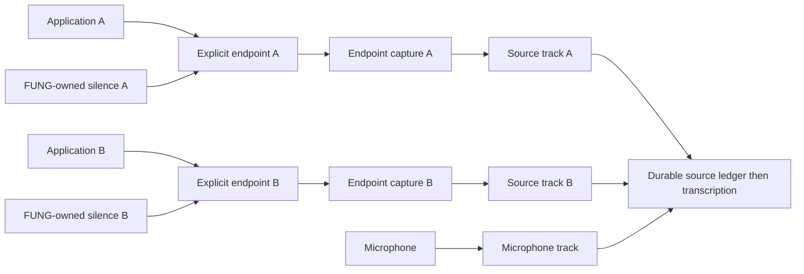

# Dedicated endpoint routing — FUNG

## Intent and authority

User direction, 2026-10-25: inspect existing devices, design routing that actually
separates applications, verify the installed package before tagging a release.
This design develops the dedicated-endpoint alternative chosen after
[#96](https://github.com/Freshair129/FUNG/issues/96) and the failed
[timer/MF experiments](../verification/implementation-reports/2026-10-25-issue-96-alternative-capture.md).
It does not assert the original Windows process-loopback defect is repaired.

Thai UI labels, named exports, existing CSS convention, anon-key-only configuration,
and surface-param routes ungated. Preserve normal profile and original failure
evidence. Keep test endpoints muted and preserve unrelated endpoint state. No fabricated PCM, relaxed
loss tolerance, default-device mutation, target injection or implicit system fallback.

## Approaches and selected direction

| Approach | Trade-off | Disposition |
| --- | --- | --- |
| Existing physical endpoints, one application per endpoint | No driver installation; finite device count; listening through several devices is inconvenient | User-selected endpoint direction; first feasibility scope, author proposes existing devices first |
| Dedicated virtual endpoints | Scales independent routes and permits a later monitored output mix; needs driver trust/license/setup and separate acceptance | Future option if physical endpoints cannot meet the approved capacity; no installation authorized by this design |
| Existing arbitrary-PID process loopback | No routing setup; known active PCM loss on this host | Existing failing path, not a fallback for routed capture |

Endpoint loopback captures the endpoint's entire mix. It does not filter PCM by
PID. Separate endpoint IDs are necessary, not sufficient, evidence of separation.
Do not describe an endpoint session allow-list as an OS-enforced access boundary.

## Current implementation and host inventory

The existing Live pipeline has microphone plus one remote channel named `system`.
System capture resolves a CPAL name/ordinal hash, then matches a unique friendly
name to a native endpoint. Application capture instead activates a target PID's
virtual process-loopback client. Both routes feed the same remote slot.
There is no implemented multi-application source selector or automatic per-app
routing. Existing generic export iteration alone does not prove multi-track capture.

Fresh inventory: `G:\AI-Studio\verification\fung-endpoint-routing-20261025\inventory-v1.json`.
16 render endpoints across all states; four active, all with 48-kHz stereo float
mix formats. Device IDs round-trip through native GetDevice; successful lookup
does not prove capture or isolation. Per-field/session errors are retained.

| Active device | Endpoint suffix | Observed constraint |
| --- | --- | --- |
| Speakers (ONIKUMA M530) | `2bcbf0fb-3a6b-40cf-8178-a38625313403` | Communications default; no active renderer at inventory snapshot; recheck before use |
| Speakers (Focusrite USB Audio) | `912e7d9e-d81a-4305-84e3-0200902d1d82` | Console/multimedia default; Dota PID 13548 active; exclude from synthetic tests |
| LM22-B200S (NVIDIA High Definition Audio) | `c7033d7f-b081-40c6-a5ff-1df83a87d352` | Candidate nondefault route; no active renderer observed |
| Mi Monitor (NVIDIA High Definition Audio) | `febdb10f-94d3-4af8-af69-b3ac1e887122` | Candidate nondefault route; no active renderer observed |

State is a time-sensitive snapshot. Reinventory immediately before each test;
never terminate an unrelated process or change its volume/routing to free a device.
The user may change unrelated endpoint mute during work; preserve that latest state,
not a stale blanket-mute instruction from earlier unattended overnight testing.
Prefer the two nondefault HDMI endpoints for unattended synthetic tests if both
open successfully. Sharing an NVIDIA adapter does not itself prove shared PCM;
measure the endpoint isolation. ONIKUMA is an alternative only after a fresh check.

## Routing contract

One independent application route uses one independent render endpoint. Reusing
an endpoint for two selected applications is an invalid route plan, not a mixer.
The first product scope is at most two remote application routes plus one microphone;
unavailable capacity is an explicit error, never a merged/mirrored source. Raising
that limit requires resource/backpressure and installed qualification first.
Two applications on one endpoint cannot be separated after the endpoint mix by
renaming tracks, speaker diarization or subtracting a reference signal.

The application chooses its output in its own documented device setting or the
Windows per-app Volume mixer. FUNG initially verifies the result; it does not use
undocumented policy interfaces to forcibly reroute arbitrary processes. Owned test
players explicitly open the chosen native endpoint. No global default is changed.
Some applications need a stream restart after routing; configuration intent alone
never changes readiness to verified. Tabs/process children are not separate apps
unless they can route independently and are explicitly included in the route.

Every route is pinned to the opaque IMMDevice endpoint ID, not a name/index or a
current default. Store name only as a display snapshot. Missing/removed/ambiguous
devices fail; do not substitute another endpoint with the same name.

The feasibility experiment compares a FUNG-owned silent stream on each endpoint
against no keeper, including target Stop/restart. A keeper retains the endpoint engine without
modifying the target process. It is an unproven repair until native tests pass;
opening a silent stream does not itself make this design accepted. Its process
and session IDs are included explicitly in the route's observed session ledger.
Closing the target's stream must not close FUNG's keeper.
Default to the simplest qualified native path; a keeper is not required merely
because the failed process-loopback investigation needed same-PID silence.

Monitoring to a common listening device is off in the first implementation.
Future monitoring must use an explicit destination outside all capture endpoints,
reject cycles/feedback, avoid routing captured audio back into another source,
and retain separate original tracks. Never unmute speakers as a side effect.

## Identity, readiness and contamination

Route input: generated route/source UUID, immutable endpoint ID, application
identity (PID plus creation time and executable identity), explicitly allowed
renderer children, and user-visible source label. Native session instance IDs are
observed provenance, not permanent client authorization tokens: a new stream owned
by the same exact live app identity remains within the approved app route. Do not
automatically authorize a new PID/process generation when an app itself restarts.
A PID/name alone
does not authorize capture after PID reuse. Browser/system cross-process sessions
are surfaced as ambiguous rather than guessed to belong to a selected app.

States: discovered → configured → verifying → armed → capturing → stopping →
completed. Absent target audio stays waiting; silence alone is not proof of route.
Missing device, unreadable session inventory, conflicting endpoint assignment,
unknown active session or incomplete source fails readiness/capture explicitly.

Preflight verifies active sessions before capture and repeats checks during the
recording, with session-create/state/device notifications plus periodic recovery
polling. A source routed to the wrong device stays unverified. A foreign session
on a capture endpoint invalidates the route; stop that source, mark its result
partial/contaminated, retain a source-scoped audit, and block normal export of the
affected source. Other tracks may finish but the complete meeting is not PASS.

**Limit:** session notification and polling are asynchronous. They detect observed
misrouting but cannot guarantee that a very short foreign stream is rejected
before any PCM reaches the endpoint buffer. This mode is configuration-based
functional separation, not a security boundary against another local process.
Do not claim a zero-leak privacy guarantee from the guard or silently discard this
limitation to close #96. If that guarantee is required, endpoint routing alone is
insufficient and an application-cooperative or OS-isolated backend is needed.

## Persistence and application integration

Native feasibility tools are external and disposable; do not mutate the normal
profile or adopt their writer into the product without review/tests.

Product integration requires a first-class source/track model rather than hiding
all routes in `system`. Each captured source retains stable source ID, endpoint
ID, application identity/observed sessions, route mode, capture epoch, sequence,
sample/QPC timing, PCM hash and source status. The builder-reviewed ownership
proposal is additive FUNG-domain tables through `genesis_adapter.rs`:

- `capture_sources`: source UUID PK, recording FK, source kind, nullable native
  endpoint ID, app-identity/session snapshots, capture epoch, policy version,
  lifecycle/contamination state and source-specific durable checkpoint.
- `capture_source_chunks`: audio-chunk UUID PK/FK to existing `audio_chunks`,
  source UUID FK to `capture_sources`, source sequence (unique with source UUID).

The existing audio chunk, source binding and both relevant checkpoints commit in
one Genesis transaction. Recording duration uses the maximum committed source end;
each source checkpoint retains its own sequence/end/hash for recovery. Apply the
binding in chunked and revisioned transcript modes. Existing meeting source-session
and transcript scope track IDs reference that same source UUID; they do not become
a second audio owner. No direct SQLite writes or parallel authoritative JSON database.

Legacy `mic`/`system` recordings keep their identity and export behavior. New source
UUIDs must not be derived from mutable labels or endpoint array positions. Use
separate source-owned directories to avoid `system-00001.wav` collisions. Capture
events, buffers, revisioned transcript tracks, recovery inventory, playback and
export all carry source identity; path parsing must not substitute for provenance.
Source clock origins are synchronized for meeting alignment while retaining each
device's independent sample clock/drift. No resampling claim without evidence.

Contamination quarantines the entire affected source epoch, not only frames after
the observation. Before completion/release of derived data, source state is checked
again; affected transcription, playback, normal export, MCP media access and agent
retrieval are blocked. Already derived transcript/summary/task artifacts retain
lineage and receive an invalidation audit/revision; never silently present them as
trusted. New routed capture initially uses persist-first, enrich-after-Stop mode.
Other sources retain their own custody but the aggregate recording is partial/FAIL.
Quarantined raw audio remains private local evidence under existing retention/access
rules; no automatic deletion or upload. This containment policy does not erase the
asynchronous-detection privacy limitation above.

## UX and MCP

Preserve existing shell/grid and the Live source tab. Add a routing table with
columns โปรแกรม / อุปกรณ์เสียงออก / สถานะ / track preview. Tabs may show individual
waveforms while recording; display each route's name, level, state and warning.
Show “รับเสียงทั้งหมดจากอุปกรณ์นี้” and the observed programs beside each endpoint.
Never label an unverified endpoint as an isolated app. Readiness is checked by
native runtime even if the UI/client provides a successful status.

MCP must expose read-only inventory and route validation before execution controls.
Capture start accepts a validated route-plan version; stale device/PID state is
revalidated. Tools report effective endpoint source mode, separate track IDs,
native errors and capability limits. Existing Product MCP authorization,
idempotency/audit and native capture/playback admission rules remain authoritative.
Do not turn the synthetic developer workflow MCP into evidence of native capture.

## Acceptance gates

1. Native inventory: exact IDs/defaults/formats/errors; no settings changes.
2. Native two-route proof: distinct nonperiodic A/B markers from independent owned
   player processes, simultaneous captures, source waveform cross-correlation and
   cross-leak measurement. Fit aligned own/foreign reference components jointly to
   avoid mistaking random marker correlation for leakage: positive own gain and
   absolute foreign/own transfer gain at most 0.001 (-60 dB). Report fit residual,
   silence RMS and alignment uncertainty separately; an ambiguous/poor fit is NOT
   PASS. This criterion is declared before capture, not tuned to the observed result.
   Retain raw PCM and full receipts.
3. Destroy/recreate each player's stream at least twice while keepers remain open.
   The played-prefix oracle uses render-clock position/frequency before and after
   Stop (before reset/drop), submitted index and remaining padding, or an independent
   endpoint control with demonstrated bounds. Submitted-but-unplayed frames purged
   by Stop are not capture loss. If the played-frame uncertainty cannot be bounded
   to the existing 48 frames, transition preservation remains NOT PROVEN; do not
   enlarge that bound. Preserve every qualified active edge; no buffer/queue loss
   or unexplained gaps. Include a keeper-disabled comparison without presuming it
   must fail on every device.
4. Negative routes: same endpoint rejected; wrong/missing endpoint rejected; inject
   an owned foreign stream on a dedicated endpoint and require contamination/failure,
   not a false per-app PASS. Test stale/reused PID and session-enumeration failure.
5. Product source review/tests: compatible source model, separate durable chunks,
   bounded writer/backpressure, tails, device removal, recovery and source export.
6. Installed package: actual native routing → record two app tracks plus microphone
   → Stop → transcription/output → independent WAVs → export/reopen. Match PCM to
   source chunks, retain source identity and saved data. Explicitly distinguish
   synthetic injected audio from human-microphone acceptance.
7. Exact-head review/CI/normal merge and release qualification. Original PID mode
   stays marked failing until repaired or separately dispositioned by an explicit
   product decision. A successful new endpoint mode does not retroactively pass it.

No tag/release while these required gates remain open.

User release decision, 2026-10-25: **keep direct-PID mode and do not release until
both PID and dedicated-endpoint modes pass**. Endpoint feasibility does not
supersede, disable or waive the failing original route. Preserve both capabilities
and their separate acceptance evidence; no tag while #96 remains open. The native
source/producer/device investigation may continue without changing that criterion.

## Primary references

- [Microsoft endpoint loopback](https://learn.microsoft.com/en-us/windows/win32/coreaudio/loopback-recording): captures the render endpoint mix.
- [Microsoft audio sessions](https://learn.microsoft.com/en-us/windows/win32/coreaudio/audio-sessions): session grouping and cross-process limits.
- [Microsoft per-app output guidance](https://support.microsoft.com/en-au/windows/hardware/audio/fix-app-audio-not-working-while-system-sounds-work-in-windows): supported user configuration path.
