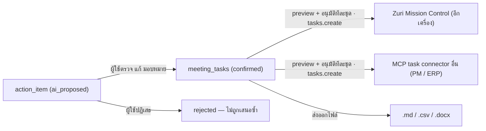

# FUNG Desktop — ยืนยัน มอบหมาย และส่งงานจากการประชุม

## 1. Classification

| Field | Value |
| --- | --- |
| Complexity | C-3 — Documentation-Driven Implementation, หลาย phase |
| Risk | HIGH — เพิ่มการเขียนข้อมูลออกนอกเครื่องครั้งแรกของ connector (เดิม read-only), เก็บ credential, เนื้อหาการประชุมออกนอกเครื่อง |
| Parent architecture | `docs/Desktop/ARCHITECTURE.md` |
| Parent feature designs | [`2026-08-11-live-meeting-external-retrieval-design.md`](2026-08-11-live-meeting-external-retrieval-design.md) (connector trust layer, preview hash, audit) · [`../plans/2026-09-30-meeting-task-manager-local-adapter.md`](../plans/2026-09-30-meeting-task-manager-local-adapter.md) (local API เดิมสำหรับ Mission Control; spec นี้ไม่ขยาย) |
| Amends | Non-goal "External writes" ของ parent retrieval design — ดู §6.1 |
| Egress | ต้องเพิ่มรายการใน `docs/appendices/E-egress-register.md` ก่อน release (§9) |
| Approval state | Draft — รอเจ้าของอนุมัติ spec และตอบ open questions §11 |

## 2. ปัญหา

ผู้ใช้คาดว่า FUNG ทำงานต่อจากสรุปประชุม (Minute of Note) ได้ครบวง คือแตก task, มอบหมายคน
แล้วส่งเข้าแอปจัดการงาน/ERP/Zuri ได้ แต่โค้ดปัจจุบัน (main `8676b1d`) มีแค่ครึ่งแรก:

| ส่วน | สถานะปัจจุบัน | หลักฐาน |
| --- | --- | --- |
| สรุป 3 มุม (`whole_story`, `timeline`, `decisions_actions`) | IMPLEMENTED | `meeting_intel::summarize_and_export`, แท็บ "สรุปและถาม" |
| Action item ที่ AI สกัด พร้อม `owner` ที่เดาได้และ evidence | IMPLEMENTED เป็น `ai_proposed` | `graph_build.rs::extraction_mutations` |
| กล่องงานที่ AI เสนอในหน้า Home | IMPLEMENTED, อ่านอย่างเดียว | `lib.rs::list_meeting_action_items`, `StudioHome.tsx` |
| ร่าง action จาก transcript ที่ตรวจแล้ว ให้ Mission Control ดึงไป | IMPLEMENTED, local API, ไม่มี UI ใน FUNG | `meeting_task_manager.rs` ("Tasks are created only in Mission Control") |
| ยืนยันงาน / แก้ / ระบุผู้รับผิดชอบ / กำหนดส่ง | **ไม่มี** | — |
| ส่งงานไประบบภายนอก | **ไม่มี**; connector รับเฉพาะ capability อ่าน และปฏิเสธชื่อที่มี `create/update/delete/write/send` | `external_mcp.rs::ConnectorCapability::from_advertised` |
| Connector UI | มี แต่ซ่อนหลัง `VITE_FUNG_EXTERNAL_MEETING_TOOLS=1` และ `FUNG_EXTERNAL_MEETING_TOOLS=1` | `ExternalMeetingToolsPanel.tsx` |

ไฟล์ `FUNG-Minute-of-Note-*.docx` และเอกสารแตกงานในโปรเจกต์ SmartGift สร้างนอกแอป
(`.tmp-transcript/...` ไม่อยู่ใน Git) จึงไม่ใช่หลักฐานว่าแอปเคยมีขั้นมอบหมาย/ส่งงาน

## 3. Decision (เสนอ)

เพิ่ม **งานที่ยืนยันแล้ว (confirmed task)** เป็นข้อมูลชั้นใหม่ในเครื่อง แยกจากข้อเสนอของ AI
แล้วให้ส่งงานที่ยืนยันแล้วออกได้ 3 ทาง โดยทุกทางเริ่มจากผู้ใช้กดเอง:

| Phase | สิ่งที่ส่ง | Network | ส่งแยกได้ |
| --- | --- | --- | --- |
| P1 ตรวจและมอบหมายในเครื่อง | — | ไม่มี | ได้ |
| P2 ส่งออกไฟล์ (รวม Minute of Note `.docx` ที่มีตารางงาน) | — | ไม่มี | ได้ หลัง P1 |
| P3 FUNG ส่งงานไป Zuri ผ่าน `tasks.create` (connector ตัวแรก) | ฟิลด์งานที่ผู้ใช้เห็นใน preview | ออกนอกเครื่อง ไปเครื่องที่รัน Zuri | ได้ หลัง P1 |
| P4 connector PM/ERP อื่นด้วยกลไกเดียวกับ P3 | ฟิลด์งานที่ผู้ใช้เห็นใน preview | ออกนอกเครื่องได้ | ได้ หลัง P3 |

**ลำดับที่ตกลง (2026-11-28):** ผู้ใช้ยืนยันว่า "Suri" คือ Zuri และให้เริ่มที่ Zuri ก่อน ลำดับจึงเป็น P1 → P3 → P2 → P4
P4 ยังอยู่ใน spec แต่ยังไม่มีระบบ PM/ERP ตัวแรก จึงเลื่อนไปจนกว่าจะเลือกระบบได้
Zuri รันบนอีกเครื่อง และผู้ใช้เลือกให้ **FUNG เป็นฝ่ายส่งออก** (ตกลง 2026-11-28, §11 Q3)
P3 จึงสร้างกลไก dispatch ทั้งหมด (§6–§7) และ P4 แค่เพิ่ม connector ตัวอื่นบนกลไกเดียวกัน

### ทางเลือกที่ไม่เลือก

- **ส่ง action item ของ AI ออกไปตรงๆ โดยไม่ยืนยัน:** ขัดกับหลัก `ai_proposed` ต้องไม่ถูกนับเป็นความจริง
  และ owner ที่ AI เดามาจาก speaker label อาจผิดคน
- **Webhook ส่ง transcript ทั้งบท + summary แบบ Call.md:** เป็นการเผยแพร่เนื้อหาการประชุมทั้งหมด
  scorecard ตัดสินให้เลื่อนไว้ก่อน (`CALLMD_FUNG_SCORECARD_TH.md` แถว "Workflow webhooks")
- **เขียน connector เฉพาะยี่ห้อ (Jira/Asana/ERP รายตัว) ใน FUNG:** parent design ไม่รับ vendor-specific connector;
  ใช้ MCP server ที่ผู้ใช้ลงทะเบียนเองแทน ยี่ห้อไหนก็ได้ถ้ามี MCP server ที่ประกาศ `tasks.create`
- **ให้ Zuri ดึงงานจาก FUNG (loopback feed ใน `meeting_task_manager.rs`):** ใช้ไม่ได้เพราะ Zuri อยู่อีกเครื่อง
  และ local API เดิมเป็น loopback only
- **เปิด local API ของ FUNG ให้เครื่องอื่นในวงแลนดึง:** ต้องเปิดพอร์ตรับ connection, เพิ่ม TLS และการจับคู่เครื่อง
  และข้อมูลประชุมจะเปิดอยู่บนเครือข่าย — ผู้ใช้ไม่เลือก (2026-11-28)
- **เขียน client เฉพาะ Zuri ใน FUNG:** ขัดกับหลักไม่ฝัง connector เฉพาะยี่ห้อ; ให้ Zuri เปิด MCP server แทน

## 4. P1 — ตรวจ แก้ และมอบหมายในเครื่อง

### 4.1 พฤติกรรม

- ทุก action item ที่ยังเป็น `ai_proposed` แสดงในส่วน **"งานจากการประชุม"** ของแท็บ "สรุปและถาม"
  และในกล่องงานหน้า Home (กล่องเดิมเพิ่มปุ่ม "ตรวจและมอบหมาย")
- ต่อรายการ ผู้ใช้ทำได้: แก้ชื่องาน, ใส่รายละเอียด, เลือกผู้รับผิดชอบ, ใส่วันกำหนดส่ง, เลือกความสำคัญ,
  **ยืนยัน** หรือ **ปฏิเสธ**; เพิ่มงานเองที่ AI ไม่ได้เสนอได้
- ช่องผู้รับผิดชอบเสนอชื่อจาก (1) speaker ที่ยืนยันตัวตนแล้วในโปรเจกต์ (2) ผู้รับผิดชอบที่เคยใช้ในโปรเจกต์
  และรับข้อความอิสระได้ ค่า `owner` ที่ AI เดาไว้แสดงเป็นคำแนะนำ ไม่กรอกให้อัตโนมัติ
- รายชื่อผู้รับผิดชอบมาจากข้อมูลในโปรเจกต์เท่านั้น ไม่ดึงรายชื่อผู้ใช้จาก Zuri หรือระบบปลายทาง
  (ตกลง 2026-11-28, §11 Q2) จึงไม่ต้องมี capability `directory.users.read`
- วันกำหนดส่ง: ถ้า transcript มีคำอย่าง "ภายในศุกร์นี้" ให้แสดงเป็นคำแนะนำพร้อม quote ไม่แปลงเป็นวันที่เอง
  (สอดคล้องกับ adapter เดิม "Date inference stays null")
- ทุกงานแสดงลิงก์กลับไปยังช่วงเสียง/segment ที่เป็นหลักฐาน
- ยืนยันหลายรายการพร้อมกันได้ แต่ต้องเห็นทุกรายการก่อนกด

### 4.2 ข้อมูล

ตารางใหม่ใน GenesisBlockDB ผ่าน schema path เดิม (`mobile.rs`):

| Table | Columns หลัก |
| --- | --- |
| `meeting_tasks` | `id`, `project_id`, `recording_id`, `source_node_id` (null ถ้าเพิ่มเอง), `title`, `description`, `assignee_label`, `assignee_ref` (null ได้), `due_date` (ISO date, null ได้), `priority` (`low`/`normal`/`high`), `status` (`confirmed`/`cancelled`), `evidence_segment_ids_json`, `revision`, `confirmed_by`, `confirmed_at`, `updated_at` |
| `meeting_task_dispatches` (ใช้ใน P3–P4) | `id`, `task_id`, `task_revision`, `target_kind` (`mcp_connector`/`file_export`), `connector_id`, `preview_hash`, `idempotency_key`, `status`, `external_ref`, `external_url`, `error_code`, `created_at`, `finished_at` |

- ยืนยันแล้ว: upsert edge `extracted_from` เดิมเป็น `confirmed` (transition ที่ `mobile.rs` อนุญาตอยู่แล้ว)
  และสร้างแถว `meeting_tasks`; ปฏิเสธ: เปลี่ยน edge เป็น `disputed` และไม่แสดงในกล่องงานอีก
- `id` ของงานกำหนดจาก `source_node_id` เพื่อให้กดยืนยันซ้ำไม่เกิดงานซ้อน; งานที่เพิ่มเองใช้ UUID
- แก้งานหลังยืนยันเพิ่ม `revision`; ประวัติการแก้เก็บใน audit event เดิม ไม่เก็บ transcript ซ้ำ
- งานที่ยืนยันแล้วไม่ถูกเขียนทับเมื่อสร้างสรุปใหม่ (rerun ได้ action item ใหม่เป็น `ai_proposed` แยกกัน)

## 5. P2 — ส่งออกไฟล์

- ปุ่ม "ส่งออกงาน" เลือกได้: Markdown (`.md`), CSV (`.csv` UTF-8 with BOM เพื่อให้ Excel อ่านภาษาไทยได้)
- **Minute of Note `.docx`:** เอกสารเดียวที่มีหัวประชุม, สรุป 3 มุม, ตารางมติ และตารางงานที่ยืนยันแล้ว
  (งาน / ผู้รับผิดชอบ / กำหนดส่ง / หลักฐาน) — เพิ่มเป็น local writer ถัดจาก `.md/.srt/.vtt` เดิม
- เขียนไฟล์ลงที่ที่ผู้ใช้เลือกผ่าน dialog เดิม ไม่มี network
- ส่งออกเฉพาะงานที่ยืนยันแล้ว; ข้อเสนอ AI ที่ยังไม่ตรวจไม่อยู่ในไฟล์ (Q5)

## 6. P3 — FUNG ส่งงานไป Zuri Mission Control

Zuri รันบนอีกเครื่อง จึงเป็น connector ปลายทางตัวแรกของ `tasks.create`
FUNG เป็นฝ่ายเปิด connection ออกไปเท่านั้น ไม่เปิดพอร์ตรับ connection จากเครื่องอื่น

- Zuri เปิด MCP server แบบ `streamable_http` (transport ที่ `external_mcp.rs::ConnectorTransport` รองรับอยู่แล้ว)
  ที่ประกาศ tool `tasks.create` ตาม payload §7.3 — ส่วนนี้อยู่ฝั่ง Zuri นอก repo นี้
- ผู้ใช้ลงทะเบียน Zuri เป็น connector ใน FUNG เหมือน connector อื่น พร้อม grant `tasks.create` ต่อโปรเจกต์
- URL ของ Zuri ต้องเป็น `https://` และ FUNG ตรวจ certificate ตามปกติ; ไม่รับ `http://` ไปเครื่องอื่น
- Credential ของ Zuri เก็บใน OS keyring ใต้ prefix `external-mcp/` เหมือน connector อื่น
- การส่งทำตาม §7.2 ทุกข้อ: preview ทุกฟิลด์ → อนุมัติ → ส่งทีละรายการพร้อม idempotency key → บันทึกผล
- ผลที่ Zuri ตอบ (`externalRef`, `externalUrl`) บันทึกใน `meeting_task_dispatches` และแสดง "ส่งเข้า Zuri แล้ว"
- local API เดิมใน `meeting_task_manager.rs` ไม่เปลี่ยน และยังเป็น loopback only

### 6.1 การแก้ parent design

Parent retrieval design ระบุ non-goal "External writes" และ `from_advertised` ปฏิเสธชื่อที่มีคำว่า create/write
spec นี้เสนอยกเว้น **หนึ่ง capability เท่านั้น**: `tasks.create` โดยคง trust layer เดิมทุกข้อ:
default deny, grant ต่อโปรเจกต์/การประชุมพร้อมวันหมดอายุ, preview hash, อนุมัติต่อครั้ง, audit, sanitize ผลลัพธ์
capability เขียนอื่นทั้งหมด (`update`, `delete`, `send`, ฯลฯ) ยังถูกปฏิเสธเหมือนเดิม
การยกเว้นนี้เริ่มใช้ใน P3

## 7. กลไก dispatch (ใช้ใน P3 และ P4)

P4 เพิ่ม connector PM/ERP อื่นที่ประกาศ `tasks.create` โดยไม่ต้องเปลี่ยนกลไกนี้

### 7.2 พฤติกรรม

1. ผู้ใช้เลือกงานที่ยืนยันแล้ว (1 ถึง 20 รายการ) → "ส่งไปยัง…" → เลือก connector ที่ลงทะเบียนและมี grant `tasks.create`
2. FUNG สร้าง preview แสดง **ทุกฟิลด์ที่จะออกจากเครื่อง** ต่อรายการ, connector, tool name, ปลายทาง, วันหมดอายุ
3. ผู้ใช้อนุมัติ preview นั้นครั้งเดียว; hash ผูกชุดงาน + `task_revision` + ฟิลด์ + connector + tool —
   แก้งานหลัง preview = preview ใช้ไม่ได้
4. Rust ส่งทีละรายการ พร้อม `idempotency_key = sha256(task_id, task_revision, connector_id)`;
   รายการที่ส่งสำเร็จแล้วจะไม่ถูกส่งซ้ำแม้กดใหม่
5. ผลแต่ละรายการบันทึกใน `meeting_task_dispatches` (สำเร็จพร้อม `external_ref`/`external_url` หรือ error code)
   และแสดงทีละรายการ ไม่ rollback รายการที่สำเร็จแล้ว

### 7.3 Payload มาตรฐาน

| Field | ที่มา | หมายเหตุ |
| --- | --- | --- |
| `title` | `meeting_tasks.title` | บังคับ, ≤ 200 ตัวอักษร |
| `description` | `meeting_tasks.description` | ผู้ใช้เลือกได้ว่าจะแนบ quote หลักฐาน (สูงสุด 3 ช่วง, ≤ 500 ตัวอักษรรวม) หรือไม่ ค่าเริ่มต้นคือไม่แนบ |
| `assignee` | `assignee_label` / `assignee_ref` | connector map เป็นผู้ใช้ปลายทางเอง; FUNG ไม่เดา |
| `dueDate` | `due_date` | ISO date หรือไม่ส่ง |
| `priority` | `priority` | |
| `sourceLabel` | ชื่อโปรเจกต์ + ชื่อการประชุม + วันที่ | ไม่มี URL เข้าเครื่องผู้ใช้ |
| `idempotencyKey` | ตาม §7.2 ข้อ 4 | |

ไม่มี transcript ทั้งบท, ไฟล์เสียง, ชื่อ speaker อื่น, deep link หรือ path ในเครื่องใน payload
connector ที่ต้องการฟิลด์เพิ่ม (เช่นรหัสโปรเจกต์ใน ERP) ประกาศผ่าน input schema ของ tool
และ FUNG แสดงเป็นช่องให้ผู้ใช้กรอกใน preview — ไม่เติมค่าจากข้อมูลประชุมเอง

### 7.4 Flag

ใช้ flag เดิม `FUNG_EXTERNAL_MEETING_TOOLS=1` + `VITE_FUNG_EXTERNAL_MEETING_TOOLS=1` และเพิ่ม
`FUNG_TASK_DISPATCH=1` สำหรับ `tasks.create` โดยเฉพาะ จนกว่าจะผ่าน UAT กับ connector จริง

## 8. UX (ร่าง)

- ส่วน "งานจากการประชุม" ในแท็บ "สรุปและถาม": รายการ ข้อเสนอ AI (ป้าย "AI เสนอ") แยกจาก "ยืนยันแล้ว"
- แต่ละงานที่ยืนยันแล้วแสดงสถานะส่ง: "ยังไม่ส่ง", "ส่งเข้า Zuri แล้ว", "ส่งไป <connector> แล้ว · เปิดดู", "ส่งไม่สำเร็จ · ลองใหม่"
- Preview sheet ของ P3/P4 ใช้ component เดิมของ `ExternalMeetingToolsPanel` แสดงฟิลด์ที่ออกจากเครื่องเป็นตาราง
- ข้อความ error ภาษาไทยแยกตามสาเหตุ: connector ไม่ตอบ, ไม่มีสิทธิ์, grant หมดอายุ, ข้อมูลไม่ครบตาม schema, ปลายทางปฏิเสธ
- Accessibility: ทุกปุ่มใช้คีย์บอร์ดได้, focus มองเห็นได้, สถานะใช้ข้อความ + สี, preview sheet คืน focus ให้ปุ่มที่เปิด

## 9. Privacy และ security invariants

- P1 และ P2 ไม่มี network call ใหม่
- ไม่มีอะไรออกจากเครื่องโดยไม่มีการกดของผู้ใช้; ไม่มีการส่งอัตโนมัติหลังประชุม
- ข้อเสนอ AI ที่ยังไม่ยืนยันไม่ถูกส่งออกผ่านทางใดเลย
- React ไม่เปิด connection ไปยัง connector และไม่เห็น credential (เหมือน parent design)
- Credential ของ connector อยู่ใน OS keyring ใต้ account prefix เดิม `external-mcp/`
- Audit ทุกครั้ง: preview, อนุมัติ, ปฏิเสธ, ผลส่งแต่ละรายการ — เก็บ hash ไม่เก็บ payload ดิบ
- FUNG ไม่เปิดพอร์ตรับ connection ใหม่; การส่งงานทุกทางเป็น outbound ที่ผู้ใช้อนุมัติ
- Connector ที่อยู่เครื่องอื่นต้องใช้ `https://` เท่านั้น
- เพิ่มรายการใน egress register: §1.11 (`tasks.create` ไป Zuri และ connector อื่น) ก่อน merge P3

## 10. Scope

### In scope

- P1–P4 ตาม §4–§7, ตารางใหม่สองตาราง, egress register และ traceability (`docs/appendices/D-traceability.md`)
- Requirement IDs ที่เสนอ (ยืนยันเลขตอนอนุมัติ):
  FR-118 ตรวจ/ยืนยัน/ปฏิเสธข้อเสนอ AI · FR-119 มอบหมายผู้รับผิดชอบและกำหนดส่ง ·
  FR-120 ส่งออกไฟล์งาน + Minute of Note `.docx` · FR-121 ส่งงานยืนยันแล้วไป Zuri Mission Control ·
  FR-122 `tasks.create` ผ่าน MCP connector แบบ preview + อนุมัติ · FR-123 สถานะการส่งต่องานและกันส่งซ้ำ

### Out of scope

- ดึงสถานะกลับจากระบบปลายทาง (งานเสร็จแล้วใน Jira แล้วสะท้อนกลับ FUNG) — v2
- แก้หรือลบงานในระบบปลายทางจาก FUNG
- Webhook / ส่ง transcript ทั้งบท
- Connector เฉพาะยี่ห้อที่ฝังใน FUNG
- การยืนยันตัวตน speaker อัตโนมัติเพื่อเติมผู้รับผิดชอบ (อยู่ใน speaker-identification spec)
- MCP server ฝั่ง Zuri (อยู่นอก repo นี้; spec นี้กำหนดแค่ tool contract `tasks.create` ตาม §7.3)
- เปิด local API ของ FUNG ให้เครื่องอื่นเข้าถึง

## 11. Open questions (ต้องตอบก่อนอนุมัติ)

1. ~~**ปลายทางแรกคืออะไร**~~ **ตอบแล้ว 2026-11-28:** "Suri" คือ Zuri Mission Control และเริ่มที่ Zuri ก่อน
   ระบบ PM/ERP ตัวแรกสำหรับ P4 ยังไม่เลือก จะถามอีกครั้งก่อนเริ่ม P4
2. ~~**รายชื่อผู้รับผิดชอบ**~~ **ตอบแล้ว 2026-11-28:** ใช้ชื่อในโปรเจกต์เท่านั้น (speaker ที่ยืนยันแล้วและชื่อที่เคยใช้)
   ไม่ดึงรายชื่อจาก Zuri หรือระบบปลายทาง และไม่เพิ่ม `directory.users.read`
3. ~~**Zuri ดึงหรือ FUNG ส่ง**~~ **ตอบแล้ว 2026-11-28:** Zuri อยู่อีกเครื่อง และให้ FUNG เป็นฝ่ายส่งออก (§6)
   - 3a. Zuri มีหรือจะเพิ่ม MCP server แบบ HTTPS ที่ประกาศ `tasks.create` ได้ไหม ถ้าไม่ได้ ต้องเลือกทางอื่นก่อนเริ่ม P3
   - 3b. Zuri อยู่ในวงแลนเดียวกัน หรือบน internet (มีผลต่อ certificate และ egress register)
4. **ส่งหลายรายการด้วยการอนุมัติครั้งเดียว:** parent design บังคับอนุมัติต่อ call; §7.2 เสนอให้หนึ่ง preview ครอบชุด
   (≤ 20 รายการ, hash ผูกทั้งชุด) — รับได้หรือต้องอนุมัติทีละรายการ
5. **`.docx`:** ต้องการ Minute of Note เป็น `.docx` จริงหรือ `.md` พอ และควรใส่ข้อเสนอ AI ที่ยังไม่ตรวจไหม
6. ~~**ลำดับ phase**~~ **ตอบแล้ว 2026-11-28 (ตามข้อ 1):** P1 → P3 → P2 → P4

## 12. Acceptance criteria

P1
- Action item ที่ AI เสนอ ยืนยันแล้วกลายเป็นแถว `meeting_tasks` และ edge เป็น `confirmed`; ปฏิเสธแล้ว edge เป็น `disputed` และไม่กลับมาในกล่องงาน
- กดยืนยันข้อเสนอเดิมซ้ำไม่สร้างงานซ้อน; สร้างสรุปใหม่ไม่เขียนทับงานที่ยืนยันแล้ว
- ระหว่างใช้ P1 ไม่มี network connection ใหม่ (ตรวจด้วย test ที่ไม่มี transport หรือ packet capture ใน UAT)

P2
- ไฟล์ `.csv` เปิดใน Excel แล้วภาษาไทยถูกต้อง; `.docx` มีตารางงานครบทุกงานที่ยืนยันแล้ว และไม่มีข้อเสนอที่ยังไม่ตรวจ

P3
- ส่งงานไป Zuri จำลอง (MCP server `streamable_http` ใน test) ได้ผลตรง §7.3 ทุกฟิลด์ และไม่มีฟิลด์อื่น
- URL `http://` ไปเครื่องอื่นถูกปฏิเสธ; certificate ผิดถูกปฏิเสธ
- Capability อื่นที่มี create/update/delete/write/send ยังถูกปฏิเสธ (test เดิม `contract_rejects_unapproved_or_write_capabilities` ยังผ่าน เพิ่มเฉพาะ `tasks.create`)
- แก้งานหลังสร้าง preview แล้วกดส่ง → ถูกปฏิเสธด้วย preview mismatch
- ส่งซ้ำด้วยงาน/revision เดิม → ไม่เกิด call ใหม่ (idempotency); Zuri ล้มกลางชุด → รายการที่สำเร็จคงสถานะสำเร็จ
- ส่งสำเร็จแล้ว FUNG แสดง "ส่งเข้า Zuri แล้ว" พร้อม `externalRef`
- ไม่มี listener ใหม่ที่รับ connection จากนอกเครื่อง; local API เดิมยังเป็น loopback only
- ค้นใน log/audit/DB แล้วไม่พบ credential หรือ payload ดิบ

P4
- ลงทะเบียน connector PM/ERP ตัวที่สองแล้วส่งงานได้ โดยไม่แก้โค้ดกลไก dispatch
- ทุกข้อของ P3 ผ่านกับ connector ตัวที่สอง

ทุก phase
- `cargo fmt --check`, `cargo clippy -D warnings`, `cargo test --lib`, frontend tests, `npm run design-system:check` และ `git diff --check` ผ่าน
- UAT บน installed build ต่อ phase ก่อนปิด flag

## Version Diff

| Version | Change |
| --- | --- |
| 0.1.0b | First draft: confirmed-task layer, file export, Mission Control feed and a single `tasks.create` connector capability. |
| 0.1.1b | Recorded owner answers: "Suri" is Zuri and Zuri comes first; phase order is now P1 → P3 → P2 → P4, and P4 waits for a PM/ERP choice. |
| 0.1.2b | Recorded owner answer: assignees come from project names only; no remote user directory. |
| 0.1.3b | Zuri runs on another machine, so P3 is now an outbound `tasks.create` push to a Zuri MCP server over HTTPS. The loopback pull feed is dropped, and P4 reuses the same mechanism. |

## CHANGELOG

| Version | Date | Status | Summary | Commit Hash | Agent |
|---|---|---|---|---|---|
| 0.1.0b | 2026-11-27 | draft | Proposed task review/assignment and three dispatch paths after the user found no assign/send step in the current build; awaiting owner approval. | d1a1c26 | Claude |
| 0.1.1b | 2026-11-28 | draft | Owner answered Q1 and Q6: Zuri first, phases P1 → P3 → P2 → P4. Q2–Q5 still open. | 568539c | Claude |
| 0.1.2b | 2026-11-28 | draft | Owner answered Q2: assignees from project names only. Q3–Q5 still open. | ae765c3 | Claude |
| 0.1.3b | 2026-11-28 | draft | Owner answered Q3: Zuri is on another machine and FUNG sends out. P3 redesigned as an outbound push; new sub-questions 3a and 3b. | pending | Claude |
