# FUNG wireframe, wireflow and user-flow audit

## Scope and result

**Local frontend repair and bounded verification completed. Native end-to-end
acceptance is not established by this report.** The inspected preview is
`http://127.0.0.1:1421/app?surface=desktop`, served from the newly built Vite
`dist`. It has no Tauri bridge, project database or configured browser auth
endpoint. Unavailable data is not an empty database or a successful native read.

The [current flow contract](../../design/2026-10-16-desktop-navigation-and-flows.md)
contains structural wireframes, capture/navigation wireflows, 18 Desktop user
flows and Mobile/Web handoffs. The [interface inventory](../../design/interface-inventory.md)
maps product domains to implemented components and evidence boundaries.

The audit used source inspection, screenshots before/after repairs, browser
navigation and keyboard checks, a TypeScript/Vite build and 89 focused CPU
checks. No GPU job, microphone capture, private-source import, real device
pairing, network exposure, account login or backup restore was performed.
Existing dirty architecture/material documentation was preserved and reconciled.

## 1. Captured journey and general health

Each step below has a saved screenshot. “Usable” refers only to the observed UI
step. It does not qualify the native/provider action behind that screen.

| Step | Screen / action | General health after repair | Evidence |
| --- | --- | --- | --- |
| 1 | Home and bottom dock | Usable overview; unknown counts/status remain unknown; no fabricated activity | [Initial](assets/2026-10-16-flow-audit/01-home.jpg), [current](assets/2026-10-16-flow-audit/25-home-final.jpg) |
| 2 | Start meeting → Live | Entry works; native capture is explicitly unavailable in preview; legacy misleading tile toolbar removed | [Before](assets/2026-10-16-flow-audit/02-live.jpg), [after](assets/2026-10-16-flow-audit/10-live-fixed.jpg) |
| 3 | History → Review | No-project recovery works; detail requires explicit selection; no nested page main or implementation badge | [Before](assets/2026-10-16-flow-audit/03-history.jpg), [after](assets/2026-10-16-flow-audit/11-history-fixed.jpg) |
| 4 | Output destination | Readable light/dark surfaces and button focus/disabled states; native chooser remains unavailable | [Before](assets/2026-10-16-flow-audit/04-output.jpg), [light](assets/2026-10-16-flow-audit/12-output-fixed.jpg), [dark](assets/2026-10-16-flow-audit/15-output-dark.jpg) |
| 5 | Settings | Modal entry, Tab loop, Escape and dock focus restoration verified; auth/configuration boundary visible | [Before](assets/2026-10-16-flow-audit/05-settings.jpg), [after](assets/2026-10-16-flow-audit/13-settings-fixed.jpg) |
| 6 | More disclosure | Named actions available in DOM; export disabled without a project; navigates to explicit Review selection rather than queuing a different recording | [Menu](assets/2026-10-16-flow-audit/06-more.jpg) |
| 7 | Appearance | Three labelled selectors; no unrelated capture error/scope note; session-only light/dark behavior documented | [Before](assets/2026-10-16-flow-audit/07-appearance.jpg), [after](assets/2026-10-16-flow-audit/14-appearance-fixed.jpg) |
| 8 | Project disclosure | Unavailable read is distinct from empty; close label means close list; idle readiness claim and empty wrapper removed | [Before](assets/2026-10-16-flow-audit/08-projects.jpg), [current](assets/2026-10-16-flow-audit/26-projects-final.jpg) |
| 9 | Companion | Navigation/context capability stated accurately; opening does not start capture or inference | [Before](assets/2026-10-16-flow-audit/09-companion.jpg), [after](assets/2026-10-16-flow-audit/16-companion-fixed.jpg) |
| 10 | Home at 720×800 | Cards stack; dock reachable; document width 720, no horizontal overflow | [Capture](assets/2026-10-16-flow-audit/17-home-720.jpg) |
| 11 | Home at 393×852 | Compact Desktop layout fits; main owns scroll; dense shortcuts remain small and are not physical Mobile acceptance | [Capture](assets/2026-10-16-flow-audit/18-home-393.jpg) |
| 12 | Settings at 393×852 | Close/section choices reachable; body scroll bounded inside overlay | [Capture](assets/2026-10-16-flow-audit/19-settings-393.jpg) |
| 13 | History at 1280×600 | Main scrolls above persistent dock; one main landmark; no horizontal overflow | [Capture](assets/2026-10-16-flow-audit/20-history-short.jpg) |
| 14 | Home → Import without native | Previously silent; now shows an actionable Desktop requirement in Review, no picker/job invoked | [Before](assets/2026-10-16-flow-audit/21-import-unavailable.jpg), [after](assets/2026-10-16-flow-audit/22-import-fixed.jpg) |
| 15 | More → Pair before opening Settings | Independent overlay styles load; bounded centred dialog; unavailable reads shown; Tab/Escape verified | [Current](assets/2026-10-16-flow-audit/24-pairing-fixed.jpg) |

Initial screenshots were captured at the existing approximately 1036×884
viewport. Explicit responsive checks used DOM-reported viewport sizes. Most
after screenshots use 1280×800. Images are state evidence, not pixel-perfect
comparisons across different sizes. Every evidence image was reopened from its
saved file for visual inspection. Temporary viewport overrides were reset.

### Representative before / after

Output previously paired a dark fallback card with dark light-theme text:

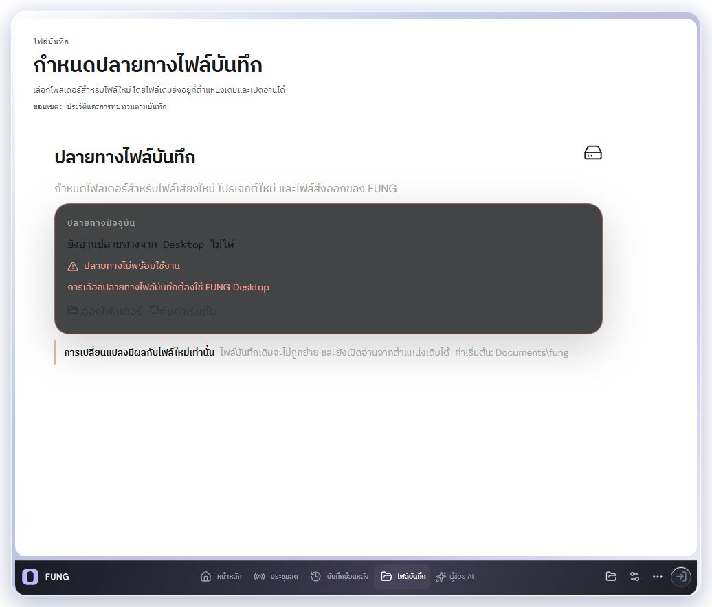

Semantic surface/ink pairing and usable control states after repair:

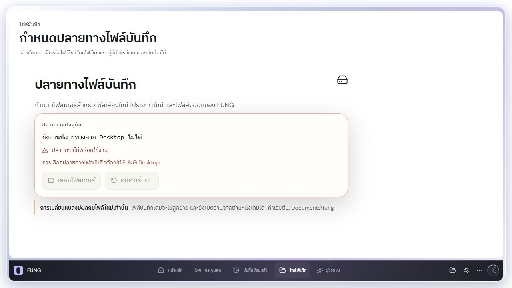

Settings now has a named modal and predictable keyboard entry/exit:

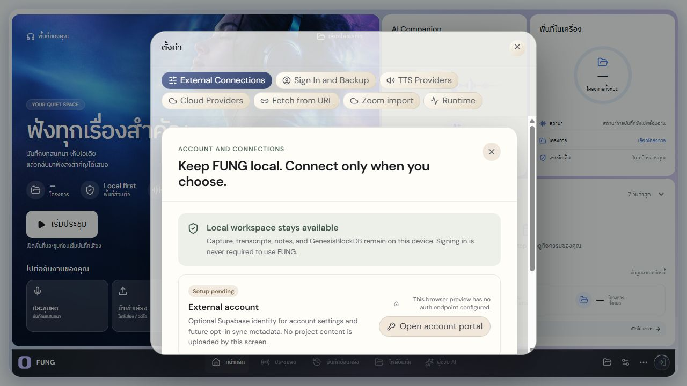

### Captured steps in flow order

1. **Home — usable overview.** Unavailable counts and capture state remain explicit.

   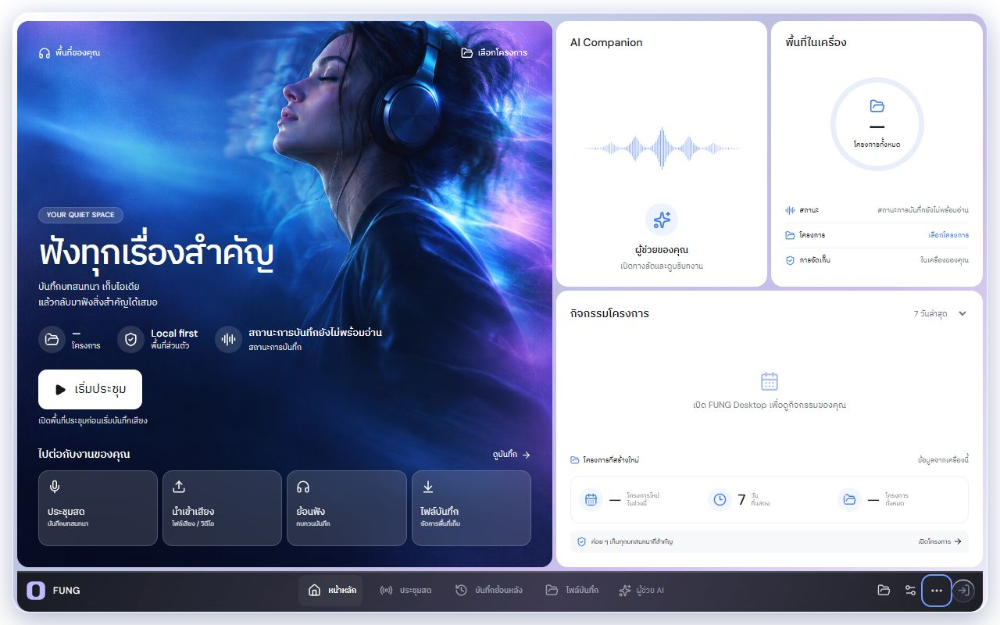

2. **Live — entry usable; capture blocked by missing native bridge.** Setup remains reachable without claiming a successful start.

   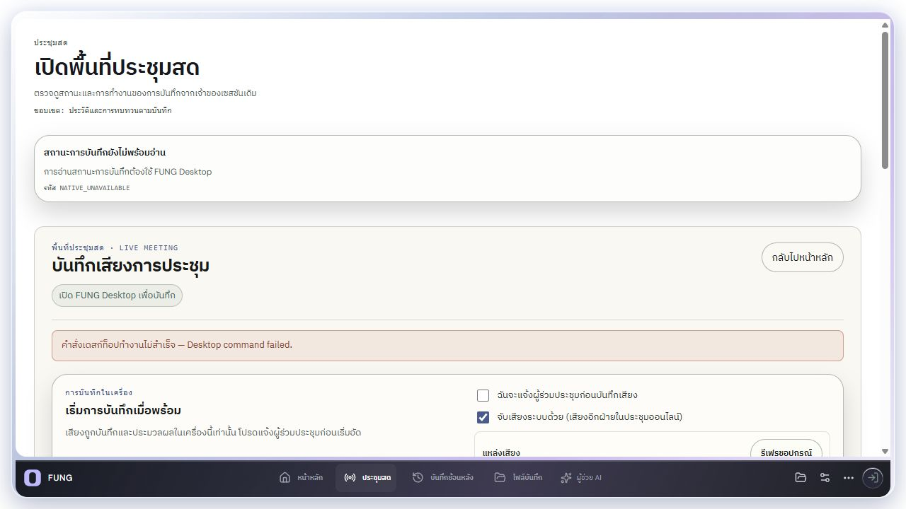

3. **History — usable no-project state.** Explicit selection is required; populated playback remains untested here.

   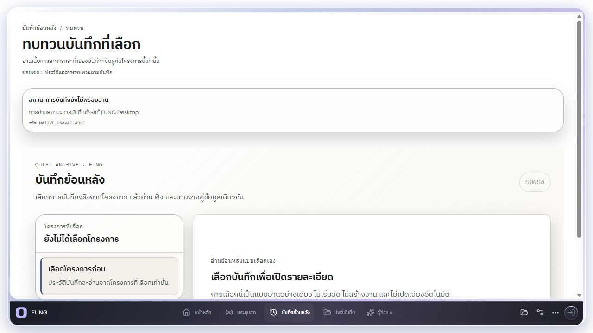

4. **Output — readable controls.** Native folder choice remains blocked in browser.

   

5. **Settings — usable modal keyboard flow.** Account configuration is unavailable in this preview.

   

6. **More — usable named actions.** Export is disabled without a project.

   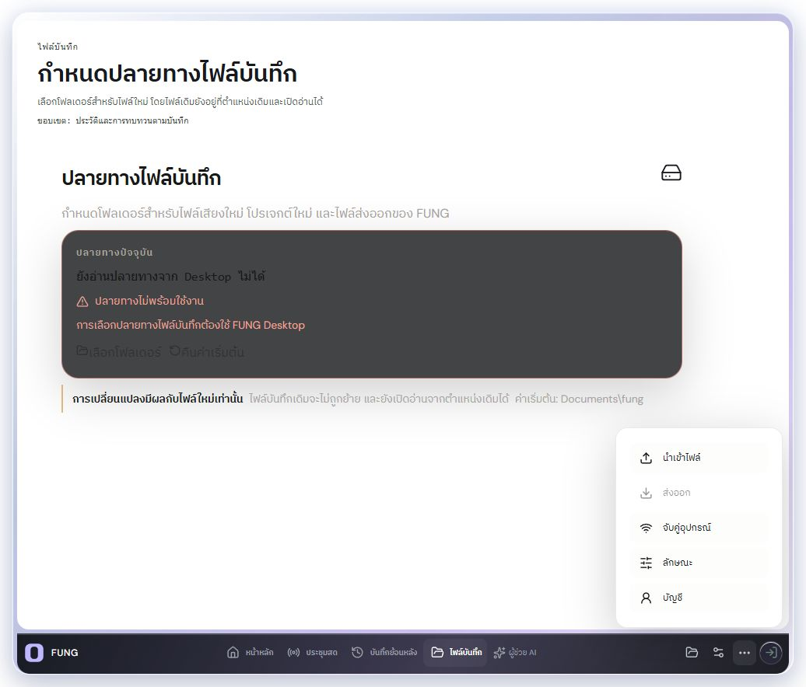

7. **Appearance — usable session controls.** Durable preferences are not implemented here.

   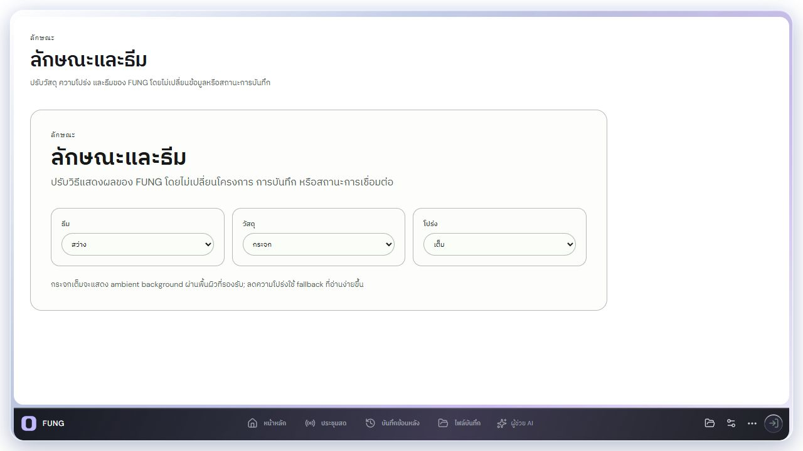

8. **Projects — honest unavailable state.** Close dismisses the list and has no database-close meaning.

   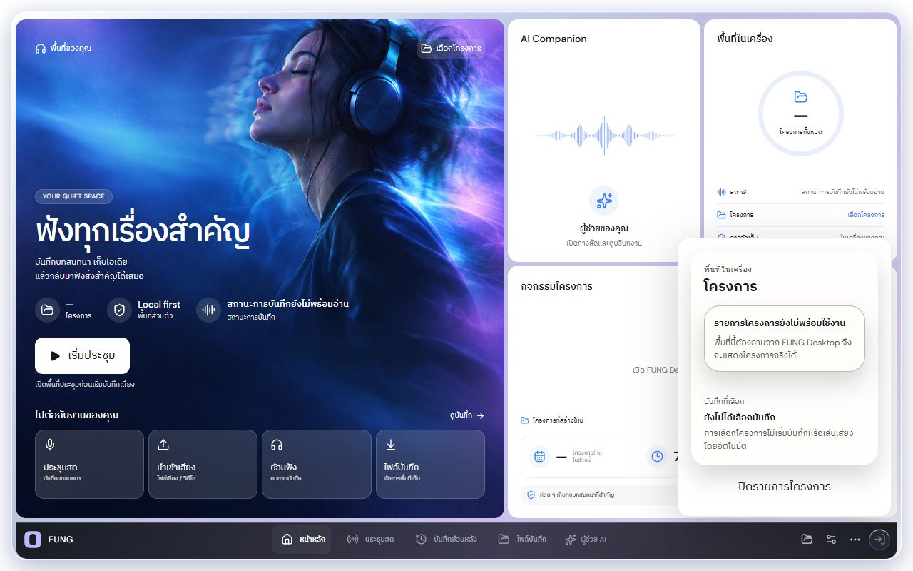

9. **Companion — usable navigation panel.** It does not offer an autonomous chat/inference session.

   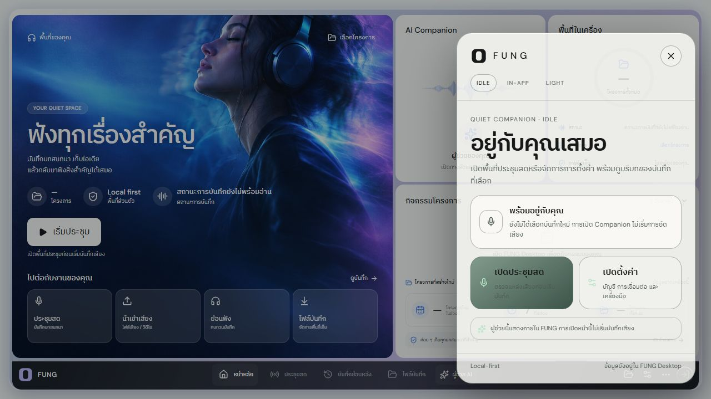

10. **Home at 720px — fits horizontally.** Main scroll and persistent dock remain available.

    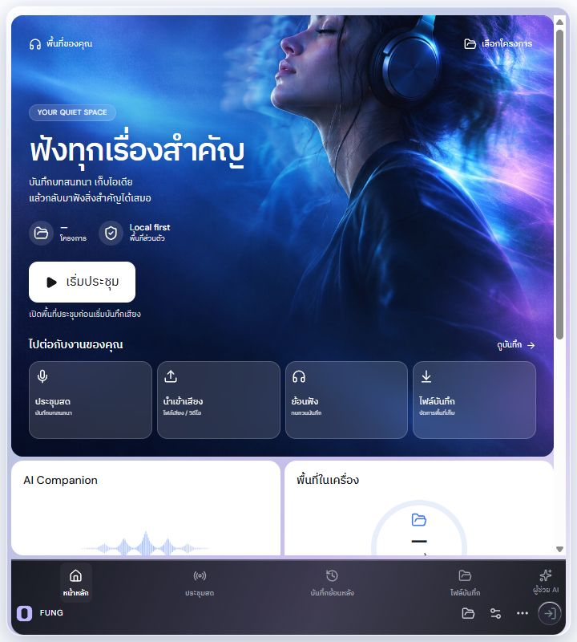

11. **Home at 393px — fits horizontally, dense.** This is compact Desktop, not native Mobile acceptance.

    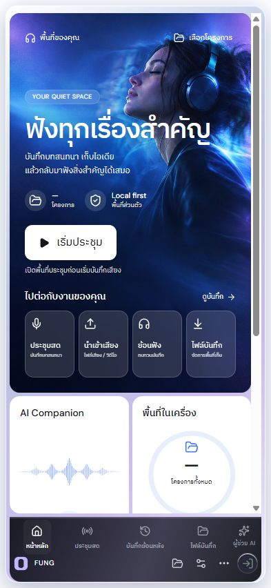

12. **Settings at 393px — controls reachable.** Content scrolls inside the bounded overlay.

    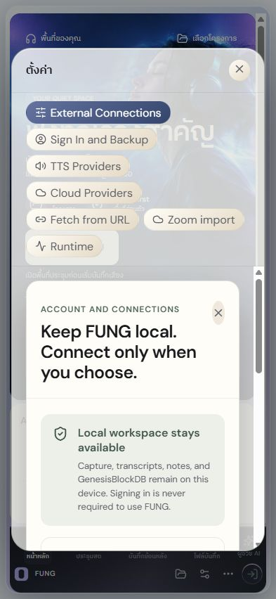

13. **Short History viewport — usable main scrolling.** The dock stays visible; populated readers need native fixtures.

    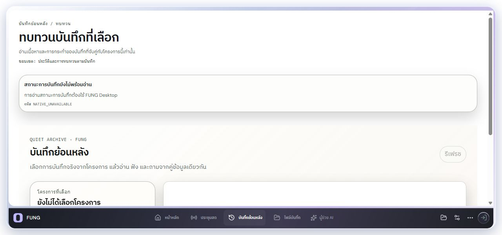

14. **Import — actionable unavailable recovery.** No silent native-less cancellation or import job.

    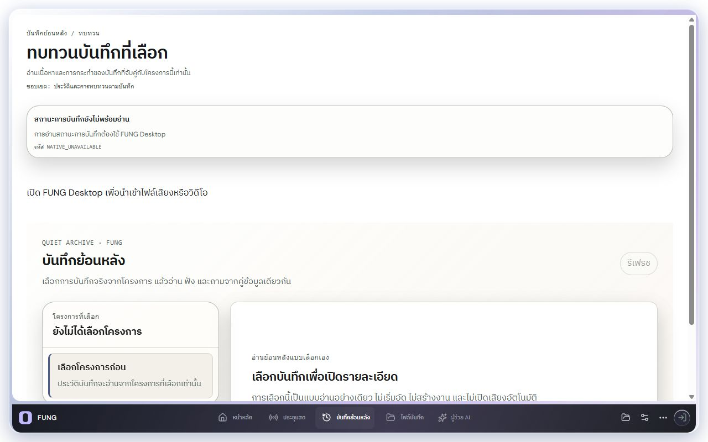

15. **Pairing — usable modal/read-error state.** Real pairing and network enablement were not executed.

    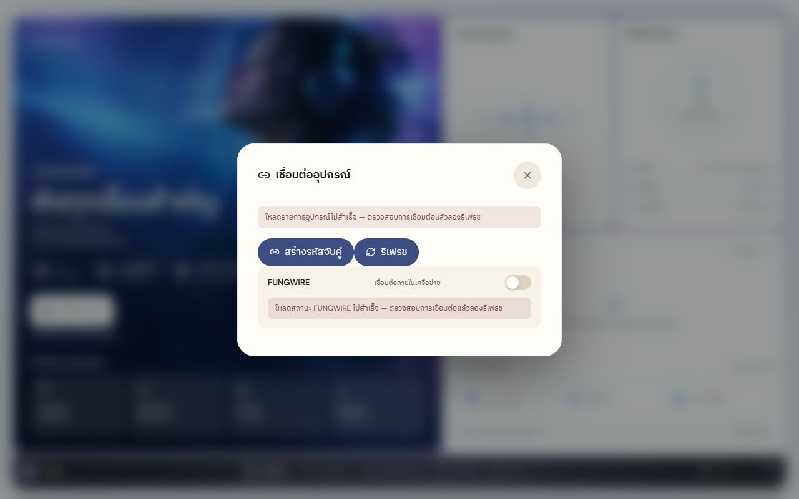

## 2. Repairs and source owners

| Finding / consequence | Repair | Source |
| --- | --- | --- |
| Citation digest described original bytes while citation carries chunk-text hash; verifier could reject the right source | Separate original file/version digest from SHA-256 of UTF-8 chunk text; do not assume future version labels are hashes | [Desktop architecture](../../Desktop/ARCHITECTURE.md) |
| Locator offsets omitted units/bases; UTF-8/UTF-16/grapheme interpretation changes selected evidence | Document zero-based Unicode scalar offsets, exclusive end, TXT/MD document base, PDF page base and one-based page/line numbers | [Desktop architecture](../../Desktop/ARCHITECTURE.md) |
| Indexes and wireframes still described hover sidebar/four surfaces | Current Studio/bottom-dock authority, five-surface mapping and historical supersession notices; preserve feature contracts | [Docs index](../../README.md), [Desktop index](../../Desktop/README.md), [wireframe index](../../Desktop/wireframes/README.md), [design index](../../design/README.md) |
| Live/Review legacy action tile advertised static status and actions outside the current owner | Remove toolbar presentation and its unused callback; persistent Live/Review remain the only owners | [App](../../../src/App.tsx) |
| More export used project-current recording instead of explicitly selected historical pair | Open Review and instruct selection; create no job from shortcut | [App](../../../src/App.tsx), [regression](../../../tests/callmdDesktopIntegration.test.mjs) |
| Browser bootstrap fallback could appear ready to record | Normalize absent native bridge to unavailable; Live idle text explains Desktop requirement | [App](../../../src/App.tsx), [LiveWorkspace](../../../src/components/desktop/LiveWorkspace.tsx) |
| Import silently returned without native; picker/project errors occurred outside catch | Native requirement notice; include picker/project creation in try/catch; cancellation creates no import job | [App](../../../src/App.tsx), [five scenarios](../../../tests/callmdDesktopIntegration.test.mjs) |
| Output card lost contrast in light theme and buttons lacked consistent affordance | Semantic surface/ink tokens; styled 44px controls with disabled/focus states | [Output CSS](../../../src/components/desktop/RecordingOutputPanel.css) |
| Settings lacked modal focus management; embedded children claimed extra dialogs | Named modal, initial focus, visible-control Tab loop, Escape, restored focus; embedded account/cloud panels are regions | [Settings](../../../src/components/SettingsPanel.tsx), [account](../../../src/components/ExternalAccountPanel.tsx), [cloud](../../../src/components/CloudProvidersPanel.tsx) |
| Pairing opened before Settings without its shared overlay CSS; keyboard could leave panel | Load overlay stylesheet independently, modal semantics, 44px close control, focus/Tab/Escape restoration | [Pairing](../../../src/components/DevicePairingPanel.tsx), [CSS](../../../src/components/DevicePairingPanel.css) |
| Embedded Live was modal while dock remained available; Review nested a second main | Live embedded region, Review detail section | [Live](../../../src/components/LiveMeetingPanel.tsx), [Review](../../../src/components/desktop/RecordingReview.tsx) |
| Capture notices appeared in unrelated Appearance/Output; project disclosure used misleading close/readiness copy | Scope notices to Live/Review; close list label; only show session note when capture exists; hide empty recovery wrapper | [Shell](../../../src/components/desktop/DesktopShell.tsx), [Studio CSS](../../../src/components/desktop/DesktopStudio.css) |
| Companion exposed handler/material implementation copy | Explain actual Live/Settings shortcuts and in-app capability | [Companion](../../../src/components/desktop/CompanionPanel.tsx) |
| Mobile Graph search icon was enabled with no click handler | Remove dead control; explicitly record search journey as unimplemented | [MobileApp](../../../src/mobile/MobileApp.tsx) |

One suspected issue was rejected: a native accessibility snapshot omitted More
button names, but browser DOM showed valid labels and accessible names. This
was a snapshot representation issue, not evidence of unnamed application buttons.

## 3. Wireflow checks and state ownership

- Home Start opens setup; it does not start recording. Import navigates to
  Review; browser-unavailable path now explains the requirement.
- Navigation uses React `activeSurface`; `#history` is the dock link for Review,
  not a durable route. Reload starts Home. Appearance currently resets to
  Light/Glass/Full; no persistence claim is made.
- Live owner remains mounted across surfaces. Continue recording keeps owner
  and capture strip. Stop-and-leave requires inactive and non-stopping status.
  CPU controller checks cover pending/failed stops and player-close acknowledgement;
  no active native session was created in the browser.
- Review and its actions use an explicit `(projectId, recordingId)`. The shell
  export shortcut cannot queue project-current audio while historical detail is
  selected. CPU tests exercise selection, stale responses, paging, jobs and
  playback race boundaries; actual output artifacts were not regenerated here.
- Settings/Pairing: focus enters Close; Shift+Tab reaches final enabled control;
  forward Tab wraps to Close; Escape removes dialog and restores dock/More.
  Pairing was opened before Settings after reload to verify CSS independence.
  No create-code/FUNGWIRE action was executed.
- One page main was observed on Home and Review, including the short viewport.
  Browser layout checks found no horizontal overflow at 393, 720 or 1280px.
  This does not certify touch target sizing for all existing controls or all
  populated/error states.

## 4. Verification receipts

### Focused CPU campaign

Command, from repository root:

```powershell
node --test --experimental-strip-types tests/callmdDesktopShell.test.mjs tests/callmdDesktopIntegration.test.mjs tests/callmdLiveWorkspace.test.mjs tests/callmdRecordingReview.test.mjs tests/recordingOutput.test.mjs tests/meetingIntelligenceUi.test.mjs tests/captureOrchestration.test.mjs tests/desktopBootstrap.test.mjs tests/egressRegister.test.mjs
```

Result: **89 tests passed; 0 failed; 0 skipped**. Full local receipt:
[cpu-tests.txt](assets/2026-10-16-flow-audit/cpu-tests.txt).
Coverage is mixed: production controller behavior, SSR assertions and source
contract checks. It is not 89 browser journeys or native acceptance cases.
The stale hover-rail test and unknown-state readiness assertion were updated to
the current dock and honest status contract. New import scenarios cover absent
native, cancel, picker error, project creation error and successful job entry;
export callback regression asserts no job creation on shortcut entry.

### Frontend build

`npm` was not available on PATH. Equivalent checked-in tool entrypoints ran:

```powershell
node node_modules/typescript/bin/tsc
if ($LASTEXITCODE -ne 0) { exit $LASTEXITCODE }
node node_modules/vite/bin/vite.js build --logLevel warn
```

Both completed with exit code 0. Preview was reloaded from this build. This
does not rebuild/reinstall the Tauri executable or establish remote CI status.

### Document hygiene

Relative file targets in the 17 changed/new Markdown documents were checked:
all links resolved, with no missing destination files. This is file-target
validation, not a full external-URL or Markdown-anchor crawler. `git diff --check`
passed; Git reported only its existing CRLF-to-LF normalization notice for the
Liquid Glass addendum. No new relationship snapshot or preflight hashes were generated; the former generated snapshot has since been retired.

## 5. Remaining acceptance gates

| Gate | Current state / required evidence |
| --- | --- |
| Native populated-project journey | NOT_RUN this round: picker/import, capture permission/start/stop/sealing, review playback/seek, real export artifact, restart preservation |
| Three-layer knowledge UAT | SOURCE/CPU only: real encrypted source/version/locator, ACL, evidence retrieval, verification and cited answer must be exercised on an approved fixture |
| Native frame/material | Browser screenshots do not prove OS transparency, edge blur, reduced transparency, forced colors or screen-reader acceptance |
| Appearance persistence | Session-scoped behavior documented. Persisting settings across relaunch is not implemented by this repair |
| Mobile | Source route crosswalk reviewed; Graph dead control removed. No physical Android/iOS, foreground capture, pairing or transport requalification |
| Web/auth/hosted services | Configured Supabase/session required. No credential/provider/network permission change or dispatch receipt in this audit |
| Backup/restore and external publication | No user backup restored, data deleted or external message published; policy/outbox acceptance remains separate |
| Localization / broad accessibility | Existing Settings sections still mix English and Thai. No full localization, touch-target sweep, WCAG or OS assistive-technology certification |
| Git publication | Working-tree changes only; no commit, push, PR or merge performed in this task |

## CHANGELOG

| Version | Date | Status | Summary | Commit Hash | Agent |
| --- | --- | --- | --- | --- | --- |
| 1.0.0b | 2026-10-16 | beta | Saved before/after UI evidence, repaired citation semantics and bounded UI defects, reconciled 18 flows/indexes, and recorded CPU/build results with native acceptance gates. | working-tree | Codex |
